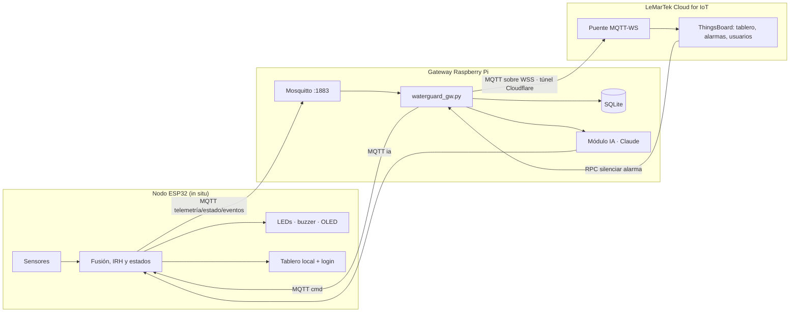
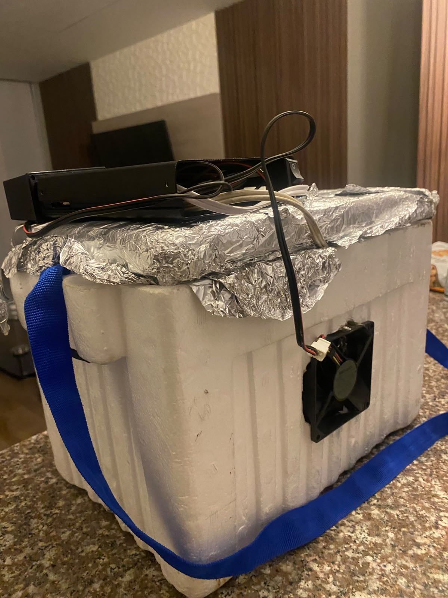
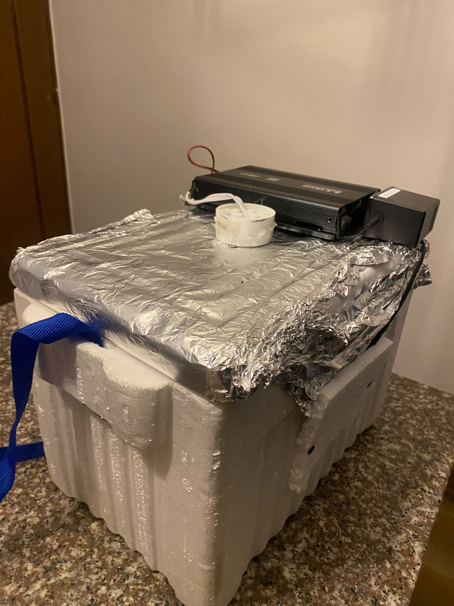
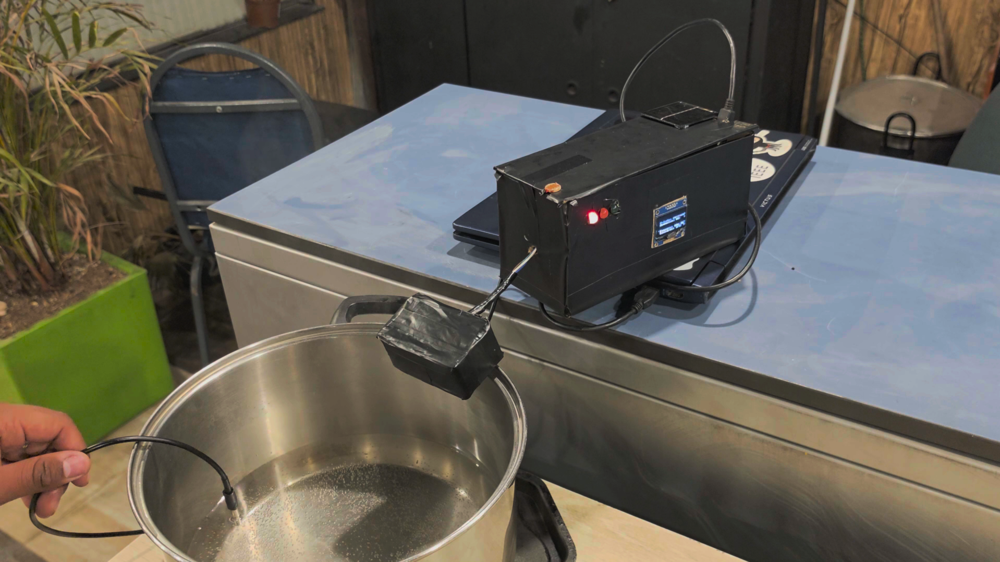
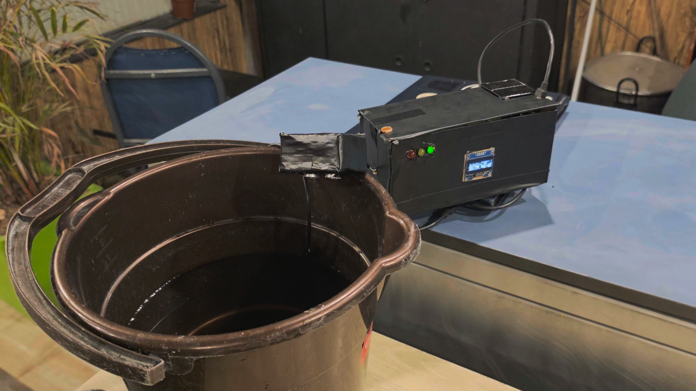
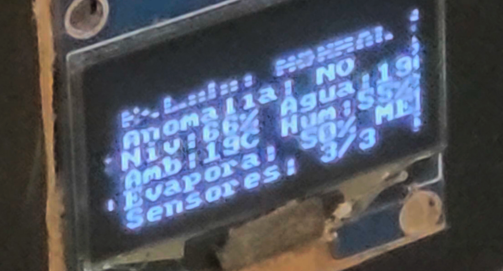
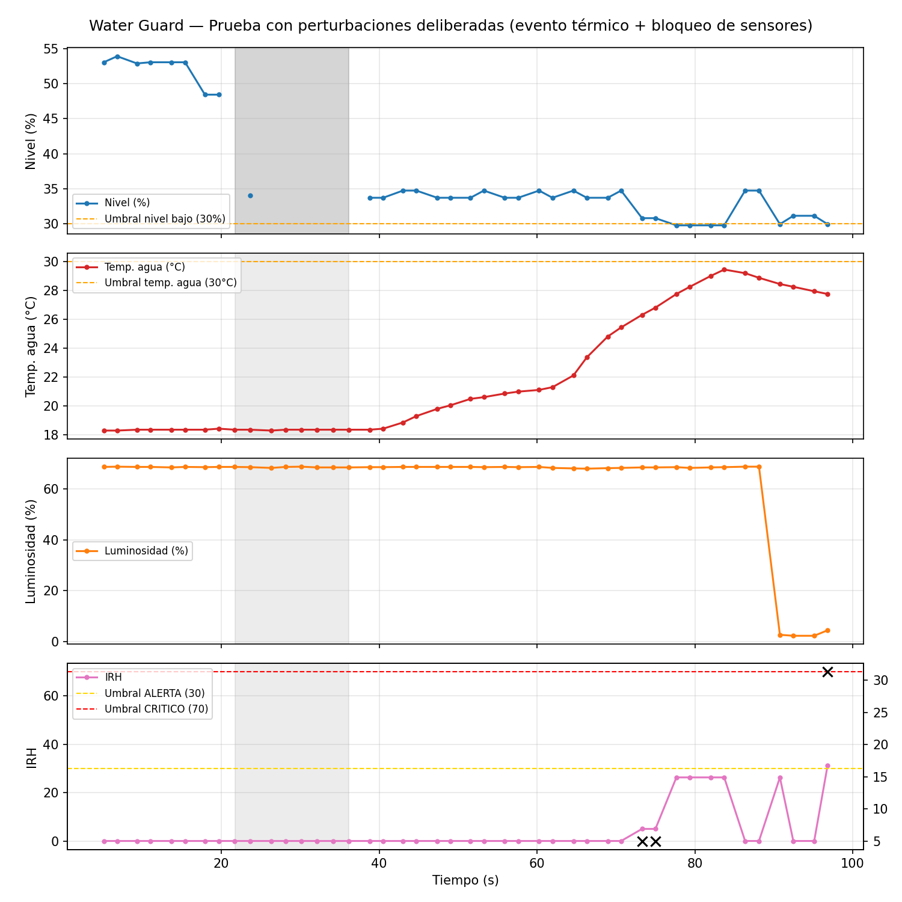
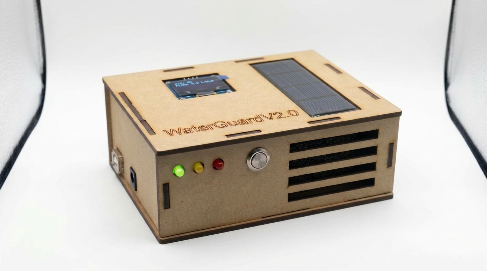
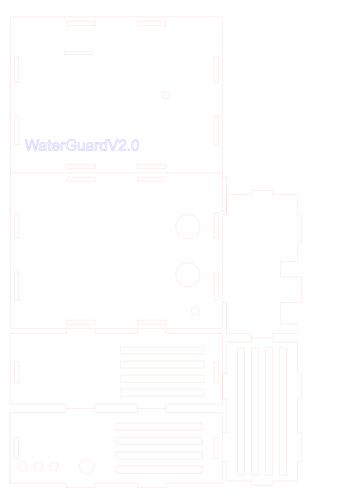

# 💧 WaterGuard v9
Sistema IoT de bajo costo para monitorear la disponibilidad y escasez de agua en puntos críticos de almacenamiento de la región Sabana Centro (Cundinamarca) frente al Fenómeno de El Niño. Un nodo **ESP32** mide el nivel del agua (con redundancia ultrasónica e hidrostática), la temperatura del agua y del aire, la humedad, la radiación y la presión; calcula un **Índice de Riesgo Hídrico (IRH)** y un **índice de evaporación potencial**, y fusiona las señales para generar alertas válidas. Los datos viajan por **MQTT** a un **Gateway IoT en Raspberry Pi**, que los guarda en **SQLite**, los procesa y los reenvía por MQTT a **LeMarTek Cloud for IoT**, la plataforma en la nube del equipo. Un **módulo de IA con Claude (Anthropic)** predice cuándo el tanque llegará al nivel crítico, detecta descensos anómalos y recomienda acciones a las autoridades.

Las alertas llegan en tres niveles:
- **In situ:** LEDs, buzzer, pantalla OLED y botón para silenciar.
- **Tablero local:** servidor web embebido en el ESP32, dentro de la WLAN de la zona, con login.
- **Tablero global:** LeMarTek Cloud (`https://iot.lemartek.cloud`), accesible desde cualquier parte de Colombia solo para usuarios autorizados, con notificaciones y control remoto de la alarma.

**Universidad de La Sabana** — Facultad de Ingeniería, Ingeniería Informática
**Curso:** IoT (Internet of Things) — 2026-2 · **Challenge #3**
**Integrantes:** Juan José Riaño Zabaleta · Santiago Peña Beltrán

> 📖 **¿Quieres profundizar?** Restricciones de diseño, arquitectura, diagramas UML, esquemáticos, estándares, modelo de negocio, protocolo de pruebas y la declaración de uso de IA están en la **[Wiki del repositorio](../../wiki)** (copia en [`wiki/`](wiki/Home.md)).

> 📝 **Actas de reunión en PDF:** se generan desde la wiki con `python codigo/scripts/actas_a_pdf.py` (requiere `pip install markdown` y Chrome o Edge) y quedan en [`docs/actas/`](docs/actas/).

---

## 🔄 De la v8 a la v9 (Challenge #3)

El segundo corte resolvía la vigilancia dentro de la WLAN de la Alcaldía, sin MQTT. El tercero exige llevar los datos a la nube pasando por un gateway con base de datos local, y sumar un módulo de IA.

| Aspecto | v8 (segundo corte) | v9 (tercer corte) |
|---|---|---|
| Arquitectura | Nodo ESP32 solo | Nodo ESP32 → Gateway Raspberry Pi → nube |
| Comunicación | HTTP local | **MQTT** nodo→gateway (Mosquitto) y gateway→nube (MQTT sobre WebSockets TLS) |
| Almacenamiento | 15 min en RAM | **SQLite** en el gateway (modo WAL), con reenvío diferido si se cae internet |
| Tablero | Solo local (ESP32) | Local (ESP32) + global (LeMarTek Cloud, ThingsBoard) |
| Notificaciones | En el tablero local | También en la nube: centro de notificaciones y alarmas por severidad |
| Silenciar alarma | Botón físico y tablero local | También desde la nube (RPC → gateway → MQTT → ESP32) |
| IA | No había | Claude: predicción, anomalías y recomendación, con respaldo estadístico local |
| Firmware | 3 tareas FreeRTOS | 4 tareas: se agrega `tMQTT` (núcleo 0) con cola de 120 muestras y LWT |

---

## 🏗️ Arquitectura del sistema



| Capa | Dónde corre | Qué hace |
|---|---|---|
| **Nodo** | ESP32 DevKit V1 | Mide con ISR y tareas FreeRTOS, fusiona señales, decide el estado, alerta in situ, sirve el tablero local y publica por MQTT |
| **Gateway** | Raspberry Pi 5 (Raspberry Pi OS) | Broker Mosquitto con usuario y clave, valida y suaviza los datos, los guarda en SQLite **antes** de transmitirlos, calcula la tendencia, llama a la IA y reenvía a la nube |
| **Nube** | LeMarTek Cloud for IoT (ThingsBoard CE en Docker, servidor propio publicado solo por túnel de Cloudflare) | Tablero global, histórico, alarmas, notificaciones, usuarios por rol (administrador y autoridad) y comando remoto de la alarma |

### Tópicos MQTT
| Tópico | Sentido | Contenido |
|---|---|---|
| `waterguard/nodo1/telemetria` | Nodo → gateway | Lecturas cada 5 s (`seq`, `edad_ms` para el buffer offline) |
| `waterguard/nodo1/estado` | Nodo → gateway (retenido) | Estado, IRH, reglas activas; al cambiar o cada 60 s |
| `waterguard/nodo1/eventos` | Nodo → gateway | Cambios de estado, fallas de sensores, alarma silenciada |
| `waterguard/nodo1/disponible` | Nodo → gateway (LWT) | `online` / `offline` |
| `waterguard/nodo1/cmd` | Gateway → nodo | `{"accion":"silenciar"|"rearmar","origen":...}` |
| `waterguard/nodo1/ia` | Gateway → nodo (retenido) | Resultado de la IA: horas al nivel crítico, riesgo y recomendación |

---

## 🤖 Módulo de Inteligencia Artificial

Corre en el gateway ([`codigo/gateway/ia_claude.py`](codigo/gateway/ia_claude.py)) y tiene dos capas:

1. **Base estadística local**, siempre disponible y sin internet: regresión lineal del nivel en la última hora para estimar las horas hasta el nivel crítico.
2. **Claude (API de Anthropic)**: recibe el resumen por minuto de las últimas 2 h, los eventos recientes y la base estadística, y devuelve un JSON validado contra un esquema con:
   - `riesgo` (bajo, medio, alto, crítico) y `horas_hasta_critico` → **predicción**;
   - `anomalia` y `tipo_anomalia` (fuga, consumo excesivo, evaporación por calor…) → **detección de anomalías**;
   - `recomendacion` y `acciones` para las autoridades → **recomendación**.

Se ejecuta cada 15 minutos y, además, de inmediato cuando el nodo entra en `ALERTA` o `CRITICO` (máximo una vez cada 3 minutos). Si no hay API key o la llamada falla, se usa solo la capa estadística, así que el sistema nunca queda sin predicción. El resultado aparece en la tarjeta de IA de LeMarTek Cloud, dispara la alarma "IA: riesgo alto" y se muestra en el tablero local del ESP32. Cada análisis cuesta del orden de USD 0.02.

---

## 🧩 Metodología de desarrollo

### 1. Análisis del problema y del entorno
El punto de partida fue entender el entorno real a monitorear: un tanque de agua expuesto a condiciones ambientales variables. Se identificaron los factores que inciden sobre el riesgo hídrico y la evaporación: **agua** (nivel y temperatura), **calor** (temperatura ambiente y del líquido), **caudal y viento** (movimiento de aire que acelera la evaporación), **refrigeración** (condiciones que la reducen) y la **acumulación** de estos efectos en el tiempo. En el segundo corte se sumó la necesidad de que las autoridades locales vigilen esas variables de forma remota dentro de la red de la zona.

### 2. Diseño del ambiente de pruebas
Se construyó un banco de pruebas capaz de simular ese ecosistema de forma controlada, usando una **nevera de icopor** como cámara cerrada:
- **Aluminio** en las paredes internas, para concentrar y conducir el calor de forma uniforme.
- Un **bombillo halógeno**, como fuente de calor controlada.
- **Ventiladores**, para generar caudal de aire y simular viento dentro de la cámara.

<p align="center">
  
  
</p>
<p align="center">
  
  
</p>
<p align="center"><em>Banco de pruebas — nevera de icopor forrada en aluminio para concentrar el calor, con bombillo halógeno como fuente de calor controlada y ventilador lateral para generar caudal de aire.</em></p>

### 3. Selección de sensores y migración a ESP32
La elección respondió a un balance entre **cobertura de las variables**, **costo** y **escalabilidad**. Para la v8 se migró a ESP32 porque integra WiFi (necesario para el servidor web embebido), tiene dos núcleos para separar medición y red, y cuesta menos que un Arduino con módulo WiFi externo. Se retiró el KY-018 (su dato digital de "hay luz" se deriva ahora de la fotoresistencia) y se incorporó el MD-PS002 como segunda fuente de nivel.

### 4. Conexión y validación del circuito
Cada sensor se conectó y probó de forma individual antes de integrarlos en un mismo circuito y firmware. En la migración a ESP32 se adaptó el cableado a la lógica de 3.3 V (divisor de voltaje en el ECHO del HC-SR04, pull-ups a 3.3 V) y se evitaron los pines de arranque y el ADC2, que no funciona con WiFi activo.

<p align="center">
  
  
</p>
<p align="center"><em>Figuras 1 y 2 — Montaje del primer corte (Arduino, pantalla OLED, LEDs indicadores y sensores) sobre los recipientes usados para simular el tanque de agua.</em></p>

<p align="center">
  
</p>
<p align="center"><em>Figura 3 — Pantalla OLED reportando en vivo el estado del sistema durante una corrida de prueba del primer corte.</em></p>

> Las fotos del montaje v8 en ESP32 y las capturas del tablero se documentan en la [sección 3 de la Wiki](../../wiki/3.-Configuración-Experimental,-Resultados-y-Análisis).

### 5. Desarrollo del firmware asistido por IA
La lógica de control se desarrolló mediante sesiones de **pair-programming con IA**, iterando sobre el código hasta ajustarlo a los requerimientos del reto y a los umbrales validados con datos del banco de pruebas. La declaración de uso de IA exigida por el curso (herramientas consultadas, instrucciones enviadas y cómo se validaron las respuestas) está en la **[Wiki](../../wiki)**.

<p align="center">
  
</p>
<p align="center"><em>Figura 4 — Análisis offline de una corrida de prueba con perturbaciones deliberadas (evento térmico y bloqueo de sensores), usada para validar y ajustar los umbrales de alerta/crítico del IRH.</em></p>

---

## 🚀 ¿Qué hace el nodo?
- Mide el **nivel de agua** con dos principios físicos distintos: ultrasonido desde arriba (HC-SR04) y presión hidrostática desde el fondo (MD-PS002). Si coinciden se promedian; si discrepan se usa el menor (criterio conservador para sequía) y se notifica; si uno falla, el otro mantiene el sistema operando.
- Calcula la **tasa de descenso del nivel** (%/min) por regresión lineal sobre el último minuto.
- Mide la **temperatura del agua** (DS18B20), **temperatura y humedad ambiente** (DHT11), **radiación** como proxy de luminosidad (fotoresistencia) y **presión atmosférica** (BMP280, opcional).
- Calcula un **índice de evaporación potencial** (0-100) basado en la ley de Dalton.
- Calcula el **IRH (Índice de Riesgo Hídrico)** de 0 a 100 fusionando todas las señales, con reglas compuestas como *descenso anómalo del nivel bajo calor extremo*.
- Detecta **anomalías** con media y desviación estándar sobre una ventana móvil.
- Clasifica el sistema en 5 estados: `NORMAL`, `ALERTA`, `CRITICO`, `DEGRADADO` y `ERROR`.
- Alerta **in situ** con LEDs, buzzer y OLED, aunque se caiga el WiFi.
- Publica un **tablero de control web** con valores actuales, histórico de 15 minutos, notificaciones y control de la alarma.
- Publica telemetría, estado y eventos por **MQTT** al gateway; si el gateway no está, guarda hasta 120 muestras y las envía al reconectar.
- Recibe por MQTT el comando de silenciar la alarma desde la nube y el resultado de la IA.

---

## 🧠 Arquitectura del firmware

La medición nunca pasa por el hilo principal. WiFi, la pila TCP y MQTT corren en el núcleo 0; medición y lógica en el núcleo 1.

| Componente | Tipo | Núcleo / prioridad | Responsabilidad |
|---|---|---|---|
| `isrEcho` | ISR | — | Mide el ancho del pulso del HC-SR04 y despierta a `tSensores` |
| `isrBoton` | ISR | — | Botón físico de silencio con antirrebote |
| `tSensores` | Tarea FreeRTOS | 1 / 3 | Lee todos los sensores y fusiona las dos fuentes de nivel |
| `tAnalitica` | Tarea FreeRTOS | 1 / 2 | Evaporación, IRH, anomalías, estados, eventos e histórico |
| `tSalidas` | Tarea FreeRTOS | 1 / 1 | LEDs, buzzer y OLED |
| `tMQTT` | Tarea FreeRTOS | 0 / 1 | Conexión al gateway (mDNS `waterguard-gw.local`), cola de envío, LWT, comandos e IA |
| `loop()` | Hilo principal | 1 | Solo servidor web y reconexión WiFi |

Los datos compartidos se protegen con un mutex, y el bus I2C (compartido por OLED y BMP280) tiene su propio mutex.

---

## 🌐 Tableros de control

### Local (ESP32)
Servidor HTTP embebido que no depende de internet: las gráficas se dibujan en `<canvas>`. Funciona en PC y celular.
- Estado con código de color y motivo, tanque animado, variables cada 2 s e histórico de 15 minutos.
- Notificaciones de cambios de estado, fallas, accesos y acciones sobre la alarma.
- Botón para silenciar o reactivar la alarma física, estado de la conexión MQTT y panel con la última predicción de la IA.
- Acceso en 3 capas: WPA2 de la WLAN, filtro de subred y login (clave en hash SHA-256, cookie `HttpOnly` atada a la IP, 30 min, bloqueo tras 5 intentos).

### Global (LeMarTek Cloud for IoT)
ThingsBoard CE desplegado con Docker en la infraestructura privada de LeMarTek, publicado solo por un túnel de Cloudflare (no abre puertos). Su configuración no se publica en este repositorio.
- Tablero con tanque, 9 tarjetas de variables, gráficas históricas, tarjeta de IA, tabla de alarmas y bitácora de eventos.
- **Alarmas:** nivel crítico del tanque, riesgo hídrico crítico (fusión), descenso anómalo con calor, nodo sin conexión e IA: riesgo alto.
- **Notificaciones** a administradores y autoridades al crearse, cambiar de severidad o limpiarse una alarma.
- **Botones** para silenciar y reactivar la alarma física del nodo.
- **Usuarios por rol:** administrador LeMarTek y autoridad de la Alcaldía (solo ve su tablero). Claves de mínimo 12 caracteres, bloqueo tras 5 intentos y doble factor (TOTP).

---
## 🔌 Hardware y pines (ESP32 DevKit V1)

En la placa, el número después de la "D" es el número de GPIO. Los GPIO 16 y 17 están rotulados **RX2** y **TX2**.

| Componente | Pin | Función |
|---|---|---|
| OLED SSD1306 (SDA / SCK) | D21 / D22 | Pantalla de estado (I2C) |
| BMP280 (SDA / SCL), opcional | D21 / D22 | Presión atmosférica (mismo bus I2C) |
| HC-SR04 (Trig / Echo) | D25 / D26 | Nivel por ultrasonido. ECHO con divisor 1 kΩ / 2 kΩ |
| MD-PS002 vía HX711 o HX710B (DT / SCK) | D32 / D33 | Nivel por presión hidrostática |
| DHT11 | D4 | Temperatura y humedad ambiente |
| DS18B20 | D27 | Temperatura del agua. Pull-up de 4.7 kΩ a 3.3 V |
| Fotoresistencia | D34 | Radiación / luminosidad (ADC1) |
| LED verde / amarillo / rojo | RX2 (16) / TX2 (17) / D19 | Estado del sistema (220 Ω en serie) |
| Buzzer activo | D23 | Alarma sonora, mediante transistor 2N2222 (base con 1 kΩ), alimentado a 5 V |
| Botón | D18 | Silenciar alarma in situ (a GND, pull-up interno) |

⚠️ Los sensores se alimentan a **3.3 V**; solo el HC-SR04 va a VIN (5 V). No se usan los pines 0, 2, 12 y 15 (arranque) ni el ADC2.

> El MD-PS002 es un puente de Wheatstone que entrega milivoltios, así que requiere una etapa de amplificación (HX711 o HX710B) para ser leído por el ESP32. Si no está conectado, el firmware lo detecta y el nivel se mide solo con el HC-SR04.

---

## 🚦 Estados del sistema
| Estado | LEDs | Buzzer |
|---|---|---|
| 🟢 **NORMAL** — todo en orden | Verde | Apagado |
| 🟡 **ALERTA** — el IRH supera el umbral de alerta | Amarillo | Apagado |
| 🔴 **CRITICO** — IRH alto sostenido 5 s, con histéresis para salir | Rojo | Encendido |
| 🟠 **DEGRADADO** — faltan sensores confiables para confirmar | Amarillo intermitente | Apagado |
| ⚠️ **ERROR** — ningún sensor de datos responde | Rojo intermitente | Intermitente |

La alarma silenciada se rearma sola al salir de `CRITICO`/`ERROR` o a los 10 minutos.

---

## 📊 Índices calculados

### Evaporación potencial (0-100)
Basado en la **ley de Dalton**: la evaporación es proporcional a la diferencia entre la presión de vapor en la superficie del agua y la del aire. Las presiones se calculan con la ecuación de Tetens. Es un índice relativo, no una tasa en mm/día.

| Variable | Peso |
|---|---|
| Déficit de presión de vapor (temp. agua, temp. ambiente y humedad) | 45 |
| Radiación (luminosidad) | 30 |
| Temperatura ambiente | 15 |
| Presión atmosférica | 10 |

Categorías: **BAJA** (<30), **MEDIA** (30-60), **ALTA** (≥60).

### IRH — Índice de Riesgo Hídrico (0-100)
| Variable | Peso |
|---|---|
| Nivel de agua | 40 |
| Tasa de descenso | 20 |
| Evaporación | 15 |
| Humedad baja | 15 |
| Temperatura del agua | 10 |

**Reglas de fusión:**
- **R1:** descenso anómalo del nivel + calor extremo → +20.
- **R2:** nivel bajo (<30 %) + evaporación ALTA → +10.

Cada anomalía estadística activa suma 5 puntos (máximo 4). Los índices se normalizan solo sobre los sensores disponibles, de modo que la falla de uno no invalida el cálculo.

> Los umbrales de descenso (1 y 3 %/min) están escalados para que el prototipo muestre los eventos en minutos. En campo se calibran según la dinámica real del reservorio.

---
---

## 🍓 Gateway (Raspberry Pi)

Código en [`codigo/gateway/`](codigo/gateway/) y despliegue en [`codigo/raspberry/`](codigo/raspberry/).

| Archivo | Función |
|---|---|
| `waterguard_gw.py` | Programa principal: suscripción MQTT, validación de rangos, media móvil, tasa de descenso por regresión de 15 min, hilos de reenvío e IA, comandos al nodo |
| `basedatos.py` | SQLite (modo WAL): tablas `telemetria`, `eventos`, `estados`, `ia`, con columna `enviado` para reenvío diferido |
| `plataforma.py` | Conexión MQTT a la nube (ThingsBoard o Ubidots), por TCP o WebSockets con TLS, y recepción de RPC |
| `ia_claude.py` | Módulo de IA (ver arriba) |
| `config.py` | Lee `waterguard.env` |
| `simulador_nodo.py` | Simula un ESP32 publicando por MQTT, para probar sin hardware |
| `pruebas/prueba_alerta_bd.py` | Prueba automatizada de la alerta crítica por falla de SQLite (no necesita broker) |

**Alerta crítica por falla de la base de datos:** si una escritura en SQLite falla, el Gateway avisa en la OLED y en el tablero local del ESP32 (por `.../ia`) y en LeMarTek Cloud (`alerta_bd`), y retiene las escrituras en orden hasta que la base se recupera. Ningún dato llega a la nube sin quedar antes en SQLite.

### SD lista para la Raspberry
La carpeta [`codigo/raspberry/`](codigo/raspberry/) deja una SD con Raspberry Pi OS Lite (Trixie, 64 bits) que se configura sola en el primer arranque mediante cloud-init: se conecta a la WiFi, instala Mosquitto con usuarios y ACL, el gateway como servicio `systemd` (`waterguard-gw`) y publica el nombre `waterguard-gw.local` por mDNS.

1. Copia `sd/user-data.ejemplo`, `sd/network-config.ejemplo` y `../gateway/waterguard.env.ejemplo` a `sd/user-data`, `sd/network-config` y `sd/waterguard.env`, y complétalos (WiFi, claves, API key).
2. Descarga Raspberry Pi OS Lite 64-bit en `trabajo/raspios.img` y graba: `bash grabar_sd.sh /dev/sdX`.
3. Pon la SD en la Raspberry, enciéndela y espera 5–10 minutos. La bitácora queda en `/boot/firmware/waterguard/instalacion.log`.

Para probar en un PC sin Raspberry:
```bash
cd codigo/gateway && python -m venv .venv && .venv/bin/pip install -r requirements.txt
cp waterguard.env.ejemplo waterguard.env   # completar
.venv/bin/python waterguard_gw.py          # en otra terminal: .venv/bin/python simulador_nodo.py
```

---

## 📦 Carcasa y empaque
El nodo se integra en una carcasa de **MDF de 3 mm cortada con láser** (≈ 150 × 110 × 56 mm), elegida por economía, tiempo de fabricación, facilidad de ensamble y menor impacto ambiental frente a la impresión 3D. Las plantillas de corte están en [`diseno/carcasa-mdf/`](diseno/carcasa-mdf/) y el diseño completo, en la [sección 2.8 de la Wiki](../../wiki/2.8.-Diseño-Mecánico-Carcasa-y-Empaque).

<p align="center">
  
  
</p>
<p align="center"><em>Carcasa ensamblada (foto real mejorada con IA) y plantilla de corte láser v2.0.</em></p>

En [`diseno/carcasa-impresa-3d/`](diseno/carcasa-impresa-3d/) queda la carcasa paramétrica en OpenSCAD para impresión 3D (base, tapa con alero contra lluvia, adaptador para OLED de 0.96" y soporte para tanque), con los STL y la plantilla del soporte a escala 1:1. **Se descartó** porque el plástico impreso se deforma con el calor del halógeno del banco de pruebas y del sol; se conserva como alternativa evaluada.

## 🛠️ Librerías necesarias
Desde el Gestor de Librerías del Arduino IDE:
- `U8g2`
- `DHT sensor library` (Adafruit) y `Adafruit Unified Sensor`
- `Adafruit BMP280 Library`
- `OneWire`
- `DallasTemperature`
- `PubSubClient` (Nick O'Leary) y `ArduinoJson` (Benoît Blanchon), para MQTT en la v9.

El HX710B no necesita librería: su protocolo se implementa en `leerHX710B()`. Las referencias IEEE de cada librería están en el [Anexo F de la Wiki](../../wiki/6.-Anexos).

`WiFi`, `WebServer`, `ESPmDNS`, `Wire` y `mbedtls` vienen incluidas con el núcleo ESP32. Probado con los núcleos ESP32 2.0.x y 3.x.

## 💰 Costo del prototipo
La electrónica de un nodo cuesta alrededor de **COP 220.700**, según precios de tiendas colombianas (YoRobotics y Electronilab) consultados el 28-sep-2026. Con la carcasa en MDF (COP 35.000) y el empaque (COP 10.000), el producto empacado cuesta **≈ COP 265.700**. El desglose por componente está en el [Modelo de negocio de la Wiki](../../wiki/2.7.-Modelo-de-Negocio).

## ▶️ Uso
1. Conecta los componentes según la tabla de pines (esquema completo en la [sección 2.5 de la Wiki](../../wiki/2.5.-Esquemático-de-Hardware)).
2. En [WaterGuard_v9.ino](codigo/WaterGuard_v9/WaterGuard_v9.ino), configura `WIFI_SSID` y `WIFI_PASS` con la misma red del gateway (debe ser de **2.4 GHz**), las credenciales MQTT (`MQTT_USUARIO`, `MQTT_CLAVE`, iguales a las de `waterguard.env`) y las del tablero (`USUARIO_TABLERO` y el hash SHA-256 de la clave en `HASH_CLAVE_TABLERO`). Para generar el hash:
   ```bash
   python -c "import hashlib;print(hashlib.sha256(b'TU_CLAVE').hexdigest())"
   ```
3. En el Arduino IDE, selecciona **DOIT ESP32 DEVKIT V1** y sube el código. Si se queda en "Connecting...", mantén presionado **BOOT**.
4. Prepara la SD del gateway (sección anterior) y enciende la Raspberry en la misma red.
5. Si usas el MD-PS002, enciende con la manguera **fuera del agua**: los primeros segundos se toman como referencia de 0 cm.
6. Abre el Monitor Serial a **115200 baudios**: verás los sensores detectados, la IP del tablero local y la conexión MQTT (`+MQ` en la OLED).
7. Tablero local: `http://<IP del ESP32>` o `http://waterguard.local`. Tablero global: `https://iot.lemartek.cloud`.

### Calibración del sensor de presión
La sensibilidad varía entre módulos. Anota el valor `HX crudo` del Serial con la manguera en el aire y luego sumergida a una profundidad conocida *H* (cm), y ajusta:

```
HX_CUENTAS_POR_KPA = (crudo_sumergido − crudo_aire) / (H × 0.0980665)
```


---

## 🗂️ Estructura del repositorio
```
codigo/
├── WaterGuard_v9/      Firmware del nodo ESP32 (Challenge #3)
├── gateway/            Gateway Python: MQTT → SQLite → nube + IA
├── raspberry/          SD autoconfigurable, Mosquitto y servicio systemd
├── WaterGuard_v8/      Firmware del segundo corte
├── WaterGuard_v7/      Firmware del primer corte (Arduino)
└── scripts/            Utilidades (actas a PDF)
diseno/                 Carcasa en MDF (corte láser) y carcasa impresa en 3D
wiki/                   Copia de la wiki entregada
docs/actas/             Actas de reunión en PDF
assets/                 Imágenes
```

## 📚 Más información
Este README es un resumen. El diseño completo, las justificaciones de cada umbral, los diagramas, el protocolo de pruebas con sus resultados y la declaración de uso de IA están en la **[Wiki de este repositorio](../../wiki)**. Las versiones anteriores se conservan en [WaterGuard_v8.ino](codigo/WaterGuard_v8/WaterGuard_v8.ino) y [WaterGuard_v7.ino](codigo/WaterGuard_v7/WaterGuard_v7.ino).

---
## 📑 Referencias principales
Formato IEEE. La lista completa (53 referencias) está en la [página de Referencias de la Wiki](../../wiki/Referencias).

- M. Terán, J. Aranda, H. Carrillo, D. Mendez y C. Parra, "IoT-based system for indoor location using Bluetooth Low Energy," en *2017 IEEE COLCOM*, Cartagena, Colombia, 2017, pp. 1–6, doi: 10.1109/ColComCon.2017.8088211.
- B. Khaleghi, A. Khamis, F. O. Karray y S. N. Razavi, "Multisensor data fusion: A review of the state-of-the-art," *Inf. Fusion*, vol. 14, no. 1, pp. 28–44, 2013, doi: 10.1016/j.inffus.2011.08.001.
- R. G. Allen, L. S. Pereira, D. Raes y M. Smith, *Crop Evapotranspiration*, FAO Irrigation and Drainage Paper 56. Roma: FAO, 1998 (ecuación de Tetens y DPV).
- Espressif Systems, *ESP32 Technical Reference Manual*, Versión 5.8, 2026.
