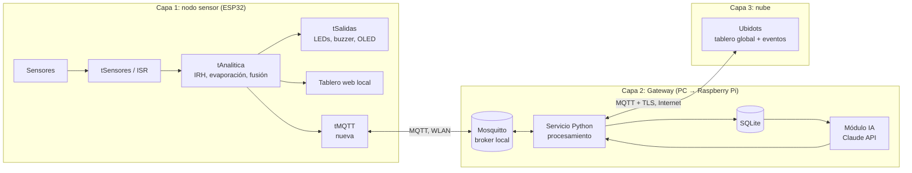

# 0. Plan del Challenge #3: de WaterGuard v8 a v9

> **Página de trabajo interno.** Registra el punto de partida, la meta, lo que falta, las decisiones técnicas y el plan para cumplir el Challenge #3. Cuando el plan esté ejecutado, su contenido se reparte en las secciones definitivas de la wiki (2.1 a 9) y esta página se retira o queda como anexo.

**Fechas límite:** documentación (wiki) el **9 de noviembre de 2026** en MS Teams · sustentación el **10 de noviembre de 2026** a la 1:00 p. m. (3 min de pitch y 17 min de preguntas). Después de la entrega en Teams **la wiki no se puede modificar**.

---

## 0.1. Iniciamos con…

WaterGuard v8, el resultado del segundo corte:

| Componente | Estado actual (v8) |
|---|---|
| Nodo sensor | ESP32 DevKit V1 con HC-SR04 y MD-PS002 (nivel redundante), DS18B20, DHT11, BMP280 y LDR |
| Concurrencia | ISR y tres tareas FreeRTOS (`tSensores`, `tAnalitica`, `tSalidas`); el `loop()` solo atiende la web |
| Analítica en el borde | Índice de evaporación (Dalton/DPV), IRH, reglas de fusión multisensor y detección de anomalías |
| Alerta in situ | LEDs, buzzer, OLED y botón físico para silenciar |
| Tablero local | Servidor web embebido (`WebServer`) en la WLAN, con valor actual, historial y alertas; login con hash SHA-256 y sesión atada a IP; silenciar alarma vía `/api/alarma` |
| Comunicación | Solo HTTP en la WLAN. **Sin MQTT**, porque lo prohibía el enunciado del segundo corte |
| Persistencia | Historial reciente en RAM del ESP32; **no hay base de datos** |
| Nube / IA | No existen. El K-Means del primer corte fue un análisis offline |

## 0.2. Meta

WaterGuard v9 como **ecosistema IoT completo de tres capas**, con integración funcional demostrable de punta a punta:

> sensor → ESP32 (ISR/FreeRTOS) → **MQTT** → **Gateway** (Mosquitto + SQLite + procesamiento) → **MQTT** → **Ubidots** (tablero global) → **módulo de IA (Claude)** → recomendación visible en los tableros local y global, y alarma silenciable desde cualquiera de ellos.

## 0.3. Lo que hace falta (brecha v8 → v9)

| # | Requisito del Challenge #3 | v8 | Qué falta |
|---|---|---|---|
| R1 | Microcontrolador con medición y **transmisión** en ISR o hilos | Medición ✅ | Tarea FreeRTOS de transmisión MQTT |
| R2 | Raspberry Pi como Gateway IoT | ❌ | Gateway completo (ver decisión D1) |
| R3 | Datos almacenados en BD local antes de ir a la nube (SQLite) | ❌ | SQLite en el Gateway |
| R4 | MQTT dispositivo ↔ Gateway (Mosquitto) | ❌ | Cliente MQTT en ESP32 + broker Mosquitto |
| R5 | MQTT Gateway ↔ plataforma IoT en la nube (Ubidots) | ❌ | Puente Gateway → Ubidots |
| R6 | Notificación in situ | ✅ | Mantener; mostrar estado de conexión en OLED |
| R7 | Tablero local embebido | ✅ | Mostrar la recomendación de la IA |
| R8 | Tablero global accesible desde cualquier parte de Colombia, solo usuarios autorizados | ❌ | Dashboard Ubidots con acceso autenticado |
| R9 | Notificaciones ante eventualidades | Parcial (local) | Eventos de Ubidots (correo / Telegram) |
| R10 | Desactivar alarmas físicas desde el tablero | Solo local | Comando desde Ubidots → Gateway → ESP32 |
| R11 | Módulo de IA (predicción, anomalías o recomendación) | ❌ | Módulo de IA en el Gateway con Claude API |
| R12 | Wiki con secciones 1–9, video ≤ 5 min, roles, declaración de IA, IEEE, compartir con `@juanmalk` | Base del 2.º corte | Actualizar todas las secciones a v9 |
| R13 | Acta de reunión y evaluación (rúbrica, 5 %) | ❌ | Actas por sesión de trabajo |

## 0.4. Decisiones tomadas

| ID | Tema | Decisión | Justificación |
|---|---|---|---|
| D1 | **No tenemos Raspberry Pi** | El Gateway se desarrolla primero en un **PC** con exactamente el mismo software que correría en la Raspberry Pi (Mosquitto + Python 3 + SQLite, empaquetado para Linux). En paralelo se **solicita una Raspberry Pi al docente**, como prevé la restricción técnica 1. | El software del Gateway es portable (Python y Mosquitto corren igual en Raspberry Pi OS). Así no bloqueamos el desarrollo. **Riesgo:** el enunciado exige Raspberry Pi; si no se consigue, hay que justificarlo ante el docente antes de la entrega. |
| D2 | **No tenemos cuenta Ubidots** | Crear una cuenta **Ubidots STEM** (gratuita, uso educativo) el primer día. | Es la plataforma recomendada por el enunciado. Los límites del plan STEM (dispositivos, variables, frecuencia de datos y canales de notificación) se verifican al crear la cuenta y condicionan la frecuencia de publicación. |
| D3 | **Proveedor de IA** | **Claude API (Anthropic)** desde el Gateway, con el SDK oficial de Python. | Es la API que el equipo ya usa. Se combina con un cálculo local para que la IA tenga datos concretos y no invente cifras (ver 0.6). |
| D4 | **Equipo de dos personas** | Se mantiene el equipo de dos (el enunciado permite "3 personas o según indique el docente"). Se reparten los roles según la sección 0.8. | Se confirma con el docente y se deja constancia en la sección 7. |

## 0.5. Implementación en el ESP32 (firmware v9)

### En efectos prácticos va a funcionar así

* El nodo **sigue funcionando exactamente igual** que en v8: mide, calcula el IRH, alerta con LEDs, buzzer y OLED, y sirve el tablero local. Si se cae el WiFi o el Gateway, **la alerta local no se pierde**.
* Además, cada pocos segundos **envía sus mediciones e indicadores** al Gateway por MQTT, y avisa de inmediato cuando cambia el estado de alerta.
* Escucha **comandos**: si una autoridad silencia la alarma desde Ubidots, el buzzer del tanque se apaga, aunque esa persona esté en otra ciudad.
* Recibe la **recomendación de la IA** que genera el Gateway y la muestra en el tablero local (y de forma resumida en la OLED).
* Si el nodo se desconecta o se apaga, el Gateway se entera solo (mensaje de "última voluntad", LWT) y lo reporta como nodo caído.

### En términos técnicos se debe implementar así

1. **Librería MQTT:** `PubSubClient` (Nick O'Leary) sobre `WiFiClient`, con `setBufferSize(1024)` porque el buffer por defecto (256 B) no alcanza para el JSON de telemetría. Alternativa evaluada: `esp-mqtt` de ESP-IDF, que publica con QoS 1 y reconecta sola, pero tiene una curva de integración mayor en el sketch actual.
2. **Nueva tarea `tMQTT`** (FreeRTOS, prioridad baja, 4–6 KB de pila). **Es la única que toca el cliente MQTT**, porque `PubSubClient` no es *thread-safe*. `tAnalitica` le entrega los datos por una **cola** (`xQueueSend`) con una estructura `Telemetria`; nunca llama a `publish()` directamente.
3. **Reconexión no bloqueante:** reintento con *backoff* (1 s → 2 s → … → 30 s máx.) y `setSocketTimeout` bajo, para que una caída del broker no congele la tarea ni afecte a la medición (que corre en otras tareas).
4. **Buffer offline:** si el broker no está disponible, las últimas *N* muestras se guardan en un buffer circular en RAM y se envían al reconectar. El campo `seq` permite al Gateway detectar huecos.
5. **Tópicos** (prefijo `waterguard/<nodo>/`, con nodo = `wg01`):

   | Tópico | Dirección | QoS | Retenido | Contenido |
   |---|---|---|---|---|
   | `telemetria` | ESP32 → GW | 0 | No | JSON con `seq`, nivel (US, hidrostático, fusionado), temperaturas, HR, presión, luz, evaporación e IRH |
   | `alerta` | ESP32 → GW | 1* | No | Cambio de estado (`NORMAL`/`PRECAUCION`/`CRITICO`), regla disparada |
   | `estado` | ESP32 → GW | 1* | Sí | `online` / `offline` (LWT), IP, *uptime*, RSSI, heap libre |
   | `cmd/alarma` | GW → ESP32 | 1 | No | `{"accion":"silenciar","origen":"ubidots"}` |
   | `ia/recomendacion` | GW → ESP32 | 1 | Sí | Texto corto y nivel de riesgo previsto |

   \* `PubSubClient` publica solo con QoS 0 (sí se suscribe con QoS 1). Para `alerta` se compensa repitiendo la publicación hasta recibir eco del Gateway en `estado`, o se migra a `esp-mqtt` si las pruebas lo justifican.
6. **Silenciar alarma unificado:** las tres fuentes (botón, tablero local y comando MQTT) llaman a una sola función `silenciarAlarma(origen)`, protegida con *mutex*, que además publica el nuevo estado para que los tres canales queden sincronizados.
7. **Seguridad en la WLAN:** usuario y contraseña MQTT por nodo y una ACL en Mosquitto (el nodo solo puede publicar en sus tópicos y leer `cmd/` e `ia/`). Las credenciales van en un `secrets.h` excluido del repositorio. **No se usa TLS dentro de la WLAN** (ver repercusiones); sí se usa entre el Gateway y Ubidots.
8. **Marcas de tiempo:** el ESP32 envía `seq` y `millis()`. El Gateway sella la hora real al recibir, para no depender de NTP en la WLAN de la Alcaldía.

### Repercusiones técnicas

| Aspecto | Repercusión | Mitigación |
|---|---|---|
| Memoria (heap/pila) | Nueva tarea, cola, buffer MQTT de 1 KB y buffer offline | Medir `ESP.getFreeHeap()` y `uxTaskGetStackHighWaterMark()` y publicarlos en `estado` |
| Concurrencia | Tablero web (en `loop()`) y MQTT comparten la pila WiFi; `PubSubClient` no es reentrante | Un solo dueño del cliente (`tMQTT`), cola entre tareas y *mutex* en el estado de alarma |
| Disponibilidad | Si cae el Gateway o el WiFi no hay datos en la nube | La alerta local es autónoma; buffer offline y LWT para detectar la caída |
| Fiabilidad de entrega | QoS 0 puede perder alguna muestra de telemetría | Aceptable para telemetría periódica; el Gateway mide la pérdida con `seq` |
| Seguridad | Sin TLS en la WLAN, el tráfico MQTT local va en claro | Red cerrada de la Alcaldía, credenciales y ACL. TLS en el ESP32 costaría ~40 KB de heap y más latencia; se documenta como trabajo futuro |
| Energía y red | Publicar más seguido consume más y puede chocar con el límite de Ubidots | Telemetría cada 5–10 s hacia el Gateway; el Gateway agrega y sube a Ubidots con menor frecuencia |
| Compatibilidad | El tablero local v8 sigue igual | Solo se agrega un panel "Recomendación IA" y un indicador de conexión MQTT |

## 0.6. Gateway, nube e IA (siguientes bloques, resumen)

* **Gateway (PC → Raspberry Pi):**
  * Mosquitto 2.x con `allow_anonymous false`, `password_file` y ACL.
  * Servicio Python con `paho-mqtt` 2.x: se suscribe a `waterguard/+/#`, guarda todo en **SQLite** (modo WAL, tablas `telemetria`, `alertas`, `comandos` y `recomendaciones`), calcula agregados (promedios por ventana, tasa de descenso del nivel, % de pérdida por `seq`) y los publica en Ubidots.
* **Ubidots:** MQTT con TLS (puerto 8883), autenticación por token y publicación en `/v1.6/devices/<device>`. El Gateway se suscribe al último valor de una variable de control (`.../silenciar/lv`) para reenviar el comando al ESP32. El dashboard lleva indicadores, históricos, estado de alerta y botón de silenciar. Los **eventos** se envían por correo o Telegram. El acceso es con login de la cuenta, nunca con un enlace público.
* **IA (Claude):** enfoque híbrido.
  1. **Predicción local** con regresión lineal sobre el nivel de los últimos 30–60 min, que estima las horas hasta el umbral crítico.
  2. **Claude** recibe ese resumen numérico (nivel, tendencia, IRH, evaporación, alertas recientes) y redacta una **recomendación accionable** de racionamiento o protección para las autoridades.

  Solo se llama a la API ante un cambio de estado o cada 15 min, para controlar el costo. Si no hay Internet o la API falla, se usa una **recomendación por reglas** como respaldo. La clave de la API va en una variable de entorno, nunca en el repositorio. Se justifica en la wiki por qué se usa IA generativa y no solo reglas: la lógica de reglas ya existe en el borde, y la IA aporta la traducción a decisiones en lenguaje natural para no expertos.

## 0.7. Plan de trabajo propuesto

| Día | Bloque | Entregable verificable |
|---|---|---|
| **Lun 3 nov** | Planeación | Esta página · cuenta Ubidots STEM · clave de la API de Anthropic · solicitud de Raspberry Pi al docente · **acta #1** |
| **Mar 4 nov** | Gateway en PC + ESP32 MQTT | Mosquitto con credenciales y ACL · servicio Python guardando en SQLite · firmware v9 publicando telemetría, estado y LWT |
| **Mié 5 nov** | Nube | Puente a Ubidots · dashboard · eventos de notificación · comando silenciar Ubidots → ESP32 funcionando |
| **Jue 6 nov** | IA | Predicción local + recomendación con Claude visible en Ubidots y en el tablero local · respaldo por reglas · migración a Raspberry Pi si ya está disponible |
| **Vie 7 nov** | Validación | Protocolo de pruebas de punta a punta: latencia sensor → Ubidots, pérdida de paquetes, caída del Gateway o WiFi, silenciar desde los tres canales, condición crítica sostenida en el banco de pruebas · **acta #2** |
| **Sáb 8 nov** | Documentación | Wiki v9 (secciones 1–9: arquitectura, UML, tópicos, esquemático, estándares, BOM, resultados, declaración de IA) · grabación del video ≤ 5 min con ambos en cámara |
| **Dom 9 nov** | Entrega | Revisión final · compartir la wiki con `@juanmalk` · subir el enlace, el video (reproducible en Teams) y el .zip a Teams |
| **Lun 10 nov** | Sustentación | Pitch de 3 min (considerar inglés, lo evalúa la rúbrica de comunicación) + demo en vivo · **acta #3** (no entra en la wiki congelada; ver [7.1](7.1.-Actas-de-Reunión-y-Evaluación)) |

**Ruta crítica:** las cuentas (Ubidots y API) y la Raspberry Pi. Si la Raspberry Pi no llega antes del jueves, se sustenta con el Gateway en PC y la justificación acordada con el docente.

## 0.8. Roles propuestos (equipo de dos)

| Integrante | Responsabilidades en el Challenge #3 |
|---|---|
| **Santiago Peña Beltrán** | Firmware v9 (tarea MQTT, comandos, panel de IA en el tablero local), hardware y esquemático, pruebas en el banco |
| **Juan José Riaño Zabaleta** | Gateway (Mosquitto, Python, SQLite), integración con Ubidots, módulo de IA con Claude, wiki, referencias IEEE y actas |
| **Conjunto** | Pruebas de punta a punta, video, pitch y sustentación |

> Propuesta inicial: se ajusta en el [acta #1](7.1.-Actas-de-Reunión-y-Evaluación).
