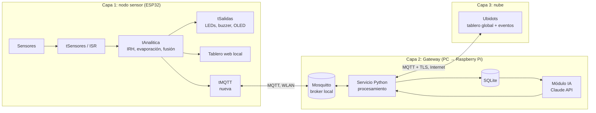
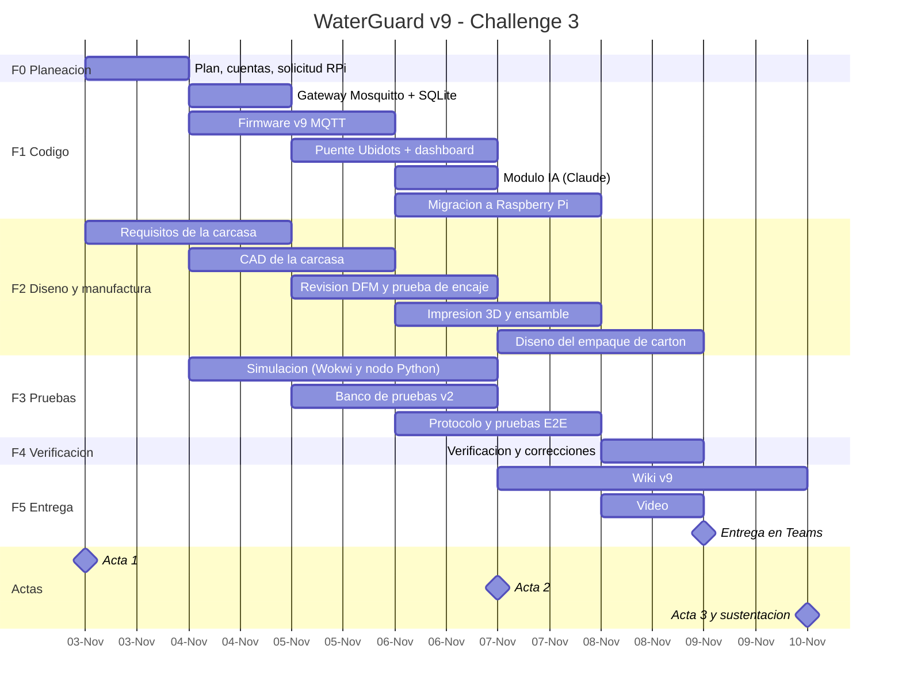

# 0. Plan del Challenge #3: de WaterGuard v8 a v9

> **Página de trabajo interno.** Registra el punto de partida, la meta, lo que falta, las decisiones técnicas y el plan para cumplir el Challenge #3. Cuando el plan esté ejecutado, su contenido se reparte en las secciones definitivas de la wiki (2.1 a 9) y esta página se retira o queda como anexo.

**Fechas límite:** documentación (wiki) el **9 de noviembre de 2026** en MS Teams · sustentación el **10 de noviembre de 2026** a la 1:00 p. m. (3 min de pitch y 17 min de preguntas). Después de la entrega en Teams **la wiki no se puede modificar**.

---

## 0.1. Iniciamos con…

WaterGuard v8, el resultado del segundo corte:

| Componente | Estado actual (v8) |
|---|---|
| Nodo sensor | ESP32 DevKit V1 con HC-SR04 y MD-PS002 (nivel redundante), DS18B20, DHT11, BMP280 y LDR |
| Concurrencia | ISR y tres tareas FreeRTOS (`tSensores`, `tAnalitica`, `tSalidas`); el `loop()` solo atiende la web |
| Analítica en el borde | Índice de evaporación (Dalton/DPV), IRH, reglas de fusión multisensor y detección de anomalías |
| Alerta in situ | LEDs, buzzer, OLED y botón físico para silenciar |
| Tablero local | Servidor web embebido (`WebServer`) en la WLAN, con valor actual, historial y alertas; login con hash SHA-256 y sesión atada a IP; silenciar alarma vía `/api/alarma` |
| Comunicación | Solo HTTP en la WLAN. **Sin MQTT**, porque lo prohibía el enunciado del segundo corte |
| Persistencia | Historial reciente en RAM del ESP32; **no hay base de datos** |
| Nube / IA | No existen. El K-Means del primer corte fue un análisis offline |

## 0.2. Meta

WaterGuard v9 como **ecosistema IoT completo de tres capas**, con integración funcional demostrable de punta a punta:

> sensor → ESP32 (ISR/FreeRTOS) → **MQTT** → **Gateway** (Mosquitto + SQLite + procesamiento) → **MQTT** → **Ubidots** (tablero global) → **módulo de IA (Claude)** → recomendación visible en los tableros local y global, y alarma silenciable desde cualquiera de ellos.

Además, la unidad física se presenta como **producto**: una **carcasa impresa en 3D** (diseñada para manufactura) que integra el ESP32, la Raspberry Pi y todos los circuitos, y el **diseño** de un empaque de cartón para su entrega. La validación se hace en un **banco de pruebas v2**, con más control y apoyado en simulación.

## 0.3. Lo que hace falta (brecha v8 → v9)

| # | Requisito del Challenge #3 | v8 | Qué falta |
|---|---|---|---|
| R1 | Microcontrolador con medición y **transmisión** en ISR o hilos | Medición ✅ | Tarea FreeRTOS de transmisión MQTT |
| R2 | Raspberry Pi como Gateway IoT | ❌ | Gateway completo (ver decisión D1) |
| R3 | Datos almacenados en BD local antes de ir a la nube (SQLite) | ❌ | SQLite en el Gateway |
| R4 | MQTT dispositivo ↔ Gateway (Mosquitto) | ❌ | Cliente MQTT en ESP32 + broker Mosquitto |
| R5 | MQTT Gateway ↔ plataforma IoT en la nube (Ubidots) | ❌ | Puente Gateway → Ubidots |
| R6 | Notificación in situ | ✅ | Mantener; mostrar estado de conexión en OLED |
| R7 | Tablero local embebido | ✅ | Mostrar la recomendación de la IA |
| R8 | Tablero global accesible desde cualquier parte de Colombia, solo usuarios autorizados | ❌ | Dashboard Ubidots con acceso autenticado |
| R9 | Notificaciones ante eventualidades | Parcial (local) | Eventos de Ubidots (correo / Telegram) |
| R10 | Desactivar alarmas físicas desde el tablero | Solo local | Comando desde Ubidots → Gateway → ESP32 |
| R11 | Módulo de IA (predicción, anomalías o recomendación) | ❌ | Módulo de IA en el Gateway con Claude API |
| R12 | Wiki con secciones 1–9, video ≤ 5 min, roles, declaración de IA, IEEE, compartir con `@juanmalk` | Base del 2.º corte | Actualizar todas las secciones a v9 |
| R13 | Acta de reunión y evaluación (rúbrica, 5 %) | ❌ | Actas por sesión de trabajo |

## 0.4. Decisiones tomadas

| ID | Tema | Decisión | Justificación |
|---|---|---|---|
| D1 | **No tenemos Raspberry Pi** | El Gateway se desarrolla primero en un **PC** con exactamente el mismo software que correría en la Raspberry Pi (Mosquitto + Python 3 + SQLite, empaquetado para Linux). En paralelo se **solicita una Raspberry Pi al docente**, como prevé la restricción técnica 1. | El software del Gateway es portable (Python y Mosquitto corren igual en Raspberry Pi OS). Así no bloqueamos el desarrollo. **Riesgo:** el enunciado exige Raspberry Pi; si no se consigue, hay que justificarlo ante el docente antes de la entrega. |
| D2 | **No tenemos cuenta Ubidots** | Crear una cuenta **Ubidots STEM** (gratuita, uso educativo) el primer día. | Es la plataforma recomendada por el enunciado. Los límites del plan STEM (dispositivos, variables, frecuencia de datos y canales de notificación) se verifican al crear la cuenta y condicionan la frecuencia de publicación. |
| D3 | **Proveedor de IA** | **Claude API (Anthropic)** desde el Gateway, con el SDK oficial de Python. | Es la API que el equipo ya usa. Se combina con un cálculo local para que la IA tenga datos concretos y no invente cifras (ver 0.6). |
| D4 | **Equipo de dos personas** | El equipo es de dos personas (el enunciado permite "3 personas o según indique el docente"). | Los roles quedan en la sección 0.11 y en la sección 7. |
| D5 | **Carcasa y empaque** | Carcasa impresa en 3D (diseño para manufactura, impresión y ensamble) que integra ESP32, Raspberry Pi y circuitos. Empaque de cartón **solo en diseño** (troquel y render), sin fabricarlo. | Presentar la solución como producto desplegable y reforzar el diseño ingenieril de la rúbrica sin desviar tiempo a fabricar el empaque. |

## 0.5. Implementación en el ESP32 (firmware v9)

### En efectos prácticos va a funcionar así

* El nodo **sigue funcionando exactamente igual** que en v8: mide, calcula el IRH, alerta con LEDs, buzzer y OLED, y sirve el tablero local. Si se cae el WiFi o el Gateway, **la alerta local no se pierde**.
* Además, cada pocos segundos **envía sus mediciones e indicadores** al Gateway por MQTT, y avisa de inmediato cuando cambia el estado de alerta.
* Escucha **comandos**: si una autoridad silencia la alarma desde Ubidots, el buzzer del tanque se apaga, aunque esa persona esté en otra ciudad.
* Recibe la **recomendación de la IA** que genera el Gateway y la muestra en el tablero local (y de forma resumida en la OLED).
* Si el nodo se desconecta o se apaga, el Gateway se entera solo (mensaje de "última voluntad", LWT) y lo reporta como nodo caído.

### En términos técnicos se debe implementar así

1. **Librería MQTT:** `PubSubClient` (Nick O'Leary) sobre `WiFiClient`, con `setBufferSize(1024)` porque el buffer por defecto (256 B) no alcanza para el JSON de telemetría. Alternativa evaluada: `esp-mqtt` de ESP-IDF, que publica con QoS 1 y reconecta sola, pero tiene una curva de integración mayor en el sketch actual.
2. **Nueva tarea `tMQTT`** (FreeRTOS, prioridad baja, 4–6 KB de pila). **Es la única que toca el cliente MQTT**, porque `PubSubClient` no es *thread-safe*. `tAnalitica` le entrega los datos por una **cola** (`xQueueSend`) con una estructura `Telemetria`; nunca llama a `publish()` directamente.
3. **Reconexión no bloqueante:** reintento con *backoff* (1 s → 2 s → … → 30 s máx.) y `setSocketTimeout` bajo, para que una caída del broker no congele la tarea ni afecte a la medición (que corre en otras tareas).
4. **Buffer offline:** si el broker no está disponible, las últimas *N* muestras se guardan en un buffer circular en RAM y se envían al reconectar. El campo `seq` permite al Gateway detectar huecos.
5. **Tópicos** (prefijo `waterguard/<nodo>/`, con nodo = `wg01`):

   | Tópico | Dirección | QoS | Retenido | Contenido |
   |---|---|---|---|---|
   | `telemetria` | ESP32 → GW | 0 | No | JSON con `seq`, nivel (US, hidrostático, fusionado), temperaturas, HR, presión, luz, evaporación e IRH |
   | `alerta` | ESP32 → GW | 1* | No | Cambio de estado (`NORMAL`/`PRECAUCION`/`CRITICO`), regla disparada |
   | `estado` | ESP32 → GW | 1* | Sí | `online` / `offline` (LWT), IP, *uptime*, RSSI, heap libre |
   | `cmd/alarma` | GW → ESP32 | 1 | No | `{"accion":"silenciar","origen":"ubidots"}` |
   | `ia/recomendacion` | GW → ESP32 | 1 | Sí | Texto corto y nivel de riesgo previsto |

   \* `PubSubClient` publica solo con QoS 0 (sí se suscribe con QoS 1). Para `alerta` se compensa repitiendo la publicación hasta recibir eco del Gateway en `estado`, o se migra a `esp-mqtt` si las pruebas lo justifican.
6. **Silenciar alarma unificado:** las tres fuentes (botón, tablero local y comando MQTT) llaman a una sola función `silenciarAlarma(origen)`, protegida con *mutex*, que además publica el nuevo estado para que los tres canales queden sincronizados.
7. **Seguridad en la WLAN:** usuario y contraseña MQTT por nodo y una ACL en Mosquitto (el nodo solo puede publicar en sus tópicos y leer `cmd/` e `ia/`). Las credenciales van en un `secrets.h` excluido del repositorio. **No se usa TLS dentro de la WLAN** (ver repercusiones); sí se usa entre el Gateway y Ubidots.
8. **Marcas de tiempo:** el ESP32 envía `seq` y `millis()`. El Gateway sella la hora real al recibir, para no depender de NTP en la WLAN de la Alcaldía.

### Repercusiones técnicas

| Aspecto | Repercusión | Mitigación |
|---|---|---|
| Memoria (heap/pila) | Nueva tarea, cola, buffer MQTT de 1 KB y buffer offline | Medir `ESP.getFreeHeap()` y `uxTaskGetStackHighWaterMark()` y publicarlos en `estado` |
| Concurrencia | Tablero web (en `loop()`) y MQTT comparten la pila WiFi; `PubSubClient` no es reentrante | Un solo dueño del cliente (`tMQTT`), cola entre tareas y *mutex* en el estado de alarma |
| Disponibilidad | Si cae el Gateway o el WiFi no hay datos en la nube | La alerta local es autónoma; buffer offline y LWT para detectar la caída |
| Fiabilidad de entrega | QoS 0 puede perder alguna muestra de telemetría | Aceptable para telemetría periódica; el Gateway mide la pérdida con `seq` |
| Seguridad | Sin TLS en la WLAN, el tráfico MQTT local va en claro | Red cerrada de la Alcaldía, credenciales y ACL. TLS en el ESP32 costaría ~40 KB de heap y más latencia; se documenta como trabajo futuro |
| Energía y red | Publicar más seguido consume más y puede chocar con el límite de Ubidots | Telemetría cada 5–10 s hacia el Gateway; el Gateway agrega y sube a Ubidots con menor frecuencia |
| Compatibilidad | El tablero local v8 sigue igual | Solo se agrega un panel "Recomendación IA" y un indicador de conexión MQTT |

## 0.6. Gateway, nube e IA (siguientes bloques, resumen)

* **Gateway (PC → Raspberry Pi):**
  * Mosquitto 2.x con `allow_anonymous false`, `password_file` y ACL.
  * Servicio Python con `paho-mqtt` 2.x: se suscribe a `waterguard/+/#`, guarda todo en **SQLite** (modo WAL, tablas `telemetria`, `alertas`, `comandos` y `recomendaciones`), calcula agregados (promedios por ventana, tasa de descenso del nivel, % de pérdida por `seq`) y los publica en Ubidots.
* **Ubidots:** MQTT con TLS (puerto 8883), autenticación por token y publicación en `/v1.6/devices/<device>`. El Gateway se suscribe al último valor de una variable de control (`.../silenciar/lv`) para reenviar el comando al ESP32. El dashboard lleva indicadores, históricos, estado de alerta y botón de silenciar. Los **eventos** se envían por correo o Telegram. El acceso es con login de la cuenta, nunca con un enlace público.
* **IA (Claude):** enfoque híbrido.
  1. **Predicción local** con regresión lineal sobre el nivel de los últimos 30–60 min, que estima las horas hasta el umbral crítico.
  2. **Claude** recibe ese resumen numérico (nivel, tendencia, IRH, evaporación, alertas recientes) y redacta una **recomendación accionable** de racionamiento o protección para las autoridades.

  Solo se llama a la API ante un cambio de estado o cada 15 min, para controlar el costo. Si no hay Internet o la API falla, se usa una **recomendación por reglas** como respaldo. La clave de la API va en una variable de entorno, nunca en el repositorio. Se justifica en la wiki por qué se usa IA generativa y no solo reglas: la lógica de reglas ya existe en el borde, y la IA aporta la traducción a decisiones en lenguaje natural para no expertos.

## 0.7. Fases del proyecto

| Fase | Nombre | Objetivo | Ventana |
|---|---|---|---|
| **F0** | Planeación | Plan, cuentas, solicitud de la Raspberry Pi y requisitos | 3 nov |
| **F1** | Implementación de código | Firmware v9, Gateway, Ubidots e IA funcionando de punta a punta | 4 – 7 nov |
| **F2** | Diseño y manufactura | Carcasa impresa en 3D que integra ESP32, Raspberry Pi y todos los circuitos (diseño para manufactura, impresión y ensamble) y **diseño** del empaque de cartón | 3 – 8 nov |
| **F3** | Banco de pruebas v2 y simulación | Banco con más control y acoples, simulación de los subsistemas y protocolo de pruebas v9 | 4 – 7 nov |
| **F4** | Verificación y correcciones | Verificar contra requisitos y rúbrica, corregir y volver a probar | 8 nov |
| **F5** | Video, documentación final y entrega | Wiki v9 completa, video ≤ 5 min y entrega en Teams | 7 – 9 nov |
| **F6** | Sustentación | Pitch de 3 min y demo | 10 nov |

### F2 en detalle: carcasa 3D (diseño para manufactura)

**Qué se busca:** una carcasa impresa en 3D en la que queden montados y protegidos el ESP32, la Raspberry Pi, los módulos (HX710B, convertidores, etc.), la alimentación y el cableado. Debe dejar bien ubicados los elementos que necesitan contacto con el exterior. Se diseña, se imprime y se ensambla.

**Criterios de diseño (DFM, *Design for Manufacturing*):**
* **Compartimentos:** uno para el nodo sensor (ESP32 + módulos) y otro para el Gateway (Raspberry Pi), separados para que el calor de la Raspberry Pi no altere la temperatura del aire medida y para que el diseño se pueda separar en dos cajas si el despliegue lo requiere.
* **Interfaz con el exterior:** ventana para la OLED; orificios para LEDs, buzzer y botón; rejilla ventilada y protegida del sol para DHT11 y BMP280; ventana para la LDR; HC-SR04 apuntando hacia el agua; prensaestopas o pasacables para DS18B20, la manguera del MD-PS002 y la alimentación; acceso al USB para reprogramar.
* **Fabricación:** paredes de ≥ 2 mm, holguras de encaje de 0,2–0,3 mm, voladizos ≤ 45° para evitar soportes, orientación de impresión definida, postes de montaje con insertos térmicos o tornillería M2,5 (Raspberry Pi) y M3, y tapa atornillada.
* **Material:** PETG o ASA para uso exterior (resisten mejor el calor y la radiación UV que el PLA). PLA solo para el prototipo de encaje.
* **Protección:** grado IP objetivo según IEC 60529 (por ejemplo IP54) como meta de diseño, documentado aunque no se certifique.
* **Riesgo:** sin la Raspberry Pi física, el compartimento se diseña con el plano mecánico oficial del modelo que se defina (T01). Si cambia el modelo, se ajusta.

**Entregables de manufactura:** archivos STEP/STL, planos con cotas, parámetros de impresión (material, capa, relleno, tiempo estimado), lista de tornillería e insertos, instrucciones de ensamble y fotos del ensamble final.

### F2 en detalle: empaque de cartón (solo diseño)

Diseño, **sin fabricación**, de una caja de cartón para entregar la unidad: troquel (*dieline*) basado en un estilo FEFCO (por ejemplo, 0427, tipo *mailer*) con dimensiones derivadas de la carcasa, inserto interno para inmovilizar la unidad y los sensores externos, y rotulado (identificación del producto, contenido, símbolos de manipulación según ISO 780). Se entregan el plano del troquel y un render o *mockup*.

### F3 en detalle: banco de pruebas v2 y simulación

* **Más control:** encendido del halógeno y velocidad del ventilador controlados (relé o PWM) para repetir los mismos escenarios; nivel de agua controlado con un recipiente graduado (y, si es posible, una bomba) para provocar descensos a una tasa conocida.
* **Acoples:** soportes fijos para cada sensor dentro de la cámara, para que las mediciones sean repetibles; montaje de la carcasa en el banco.
* **Referencias:** termómetro y regla graduada de referencia para comparar las lecturas.
* **Simulación:** firmware v9 en **Wokwi** contra un broker MQTT, y un **simulador de nodo en Python** que publica datos sintéticos (normales, sequía, anomalías) para probar el Gateway, Ubidots y la IA sin depender del hardware. También permite **inyectar fallas** (caída del WiFi, del broker o de Internet).
* **Protocolo v9:** casos de prueba con criterio de aceptación y métricas (latencia sensor → Ubidots, pérdida por `seq`, tiempo hasta alerta, tiempo de recuperación tras una caída, silenciar desde los tres canales).

## 0.8. Cronograma

| Día | F1 Código | F2 Diseño y manufactura | F3 Pruebas | F4 / F5 / F6 |
|---|---|---|---|---|
| **Lun 3** | — | Requisitos de la carcasa | — | F0 + **Acta #1** |
| **Mar 4** | Gateway (Mosquitto, Python, SQLite) · firmware v9 MQTT | Requisitos · CAD | Simulador de nodo en Python | — |
| **Mié 5** | Firmware v9 (comandos, panel IA) · puente Ubidots | CAD · revisión DFM | Simulación Wokwi · banco v2 | — |
| **Jue 6** | Dashboard y eventos Ubidots · módulo IA · migración a Raspberry Pi | Prueba de encaje · impresión | Banco v2 · protocolo v9 | — |
| **Vie 7** | Ajustes de integración | Impresión · ensamble · empaque | Pruebas E2E en banco v2 | Wiki v9 · **Acta #2** |
| **Sáb 8** | — | Empaque · documentación de manufactura | — | Verificación y correcciones · video · wiki |
| **Dom 9** | — | — | — | Revisión final · compartir con `@juanmalk` · **entrega** |
| **Lun 10** | — | — | — | Sustentación · **Acta #3** |

**Ruta crítica:** cuentas (Ubidots y API) → integración de punta a punta → pruebas E2E. En paralelo, la carcasa depende del modelo de Raspberry Pi (T01) y del tiempo de impresión, que se debe estimar en T22.

## 0.9. Lista de tareas

Estado: ⬜ pendiente · 🔄 en curso · ✅ terminada.

| ID | Fase | Tarea | Responsable | Depende de | Entregable | Fecha |
|---|---|---|---|---|---|---|
| T01 | F0 | Solicitar la Raspberry Pi al docente y definir el modelo | **Ambos** | — | Modelo confirmado | 3 nov |
| T02 | F0 | Crear cuenta Ubidots STEM y verificar límites del plan | **Santiago** | — | Cuenta y límites documentados | 3 nov |
| T03 | F0 | Crear clave de la API de Anthropic y definir presupuesto | **Santiago** | — | Clave en variable de entorno | 3 nov |
| T10 | F1 | Mosquitto: credenciales, ACL y puertos | **Santiago** | — | `mosquitto.conf`, ACL | 4 nov |
| T11 | F1 | Servicio Python: MQTT → SQLite (esquema, modo WAL) | **Santiago** | T10 | `gateway/` + BD | 4 nov |
| T12 | F1 | Firmware v9: tarea `tMQTT`, cola, LWT, buffer offline | **Santiago** | T10 | `WaterGuard_v9.ino` | 4–5 nov |
| T13 | F1 | Firmware v9: `cmd/alarma`, silenciar unificado, panel IA y estado de conexión | **Santiago** | T12 | Firmware v9 | 5 nov |
| T14 | F1 | Procesamiento en el Gateway (agregados, tasa de descenso, pérdida por `seq`) | **Santiago** | T11 | Módulo de procesamiento | 5 nov |
| T15 | F1 | Puente Gateway → Ubidots (TLS) y comando de vuelta | **Santiago** | T02, T14 | Datos en Ubidots | 5 nov |
| T16 | F1 | Dashboard Ubidots, eventos, notificaciones y acceso restringido | **Santiago** | T15 | Dashboard | 6 nov |
| T17 | F1 | Módulo IA: predicción local + Claude + respaldo por reglas | **Santiago** | T03, T14 | Recomendación publicada | 6 nov |
| T18 | F1 | Migrar el Gateway a la Raspberry Pi (servicios al arranque) | **Santiago** | T01, T17 | Gateway en Raspberry Pi | 6–7 nov |
| T19 | F1 | Documentar el código de cada módulo | **Santiago** | T12–T17 | Código comentado + README | 8 nov |
| T20 | F2 | Requisitos de la carcasa: inventario y medidas de componentes, ubicación de sensores y puertos, ventilación | **Santiago** | T01 | Lista de requisitos y croquis | 3–4 nov |
| T21 | F2 | Modelado CAD de la carcasa (compartimentos, tapa, soportes, pasacables) | **Santiago** | T20 | Modelo CAD | 4–5 nov |
| T22 | F2 | Revisión DFM (espesores, holguras, voladizos, orientación, tornillería, material) y estimación del tiempo de impresión | **Santiago** | T21 | Checklist DFM | 5–6 nov |
| T23 | F2 | Prueba de encaje e impresión final | **Santiago** | T22 | Carcasa impresa | 6–7 nov |
| T24 | F2 | Ensamble de circuitos en la carcasa y prueba funcional | **Santiago** | T23, T13 | Unidad ensamblada | 7 nov |
| T25 | F2 | Documentación de manufactura (STEP/STL, planos, parámetros, ensamble) | **Santiago** | T22 | Anexo de manufactura | 8 nov |
| T26 | F2 | Diseño del empaque de cartón (troquel FEFCO, inserto, rotulado ISO 780) | **Santiago** | T21 | Plano del troquel + render | 7–8 nov |
| T30 | F3 | Banco de pruebas v2: control de halógeno y ventilador, nivel controlado, soportes y referencias | **Juan José** | — | Banco v2 | 5–6 nov |
| T31 | F3 | Simulación: Wokwi y simulador de nodo en Python con inyección de fallas | **Juan José** | T10 | Escenarios simulados | 4–6 nov |
| T32 | F3 | Protocolo de pruebas v9 (casos, criterios, métricas) | **Juan José** | — | Protocolo | 6 nov |
| T33 | F3 | Ejecución de pruebas E2E en banco v2 y registro de evidencias | **Juan José** | T16, T17, T30, T32 | Logs, capturas, fotos | 7 nov |
| T40 | F4 | Verificación contra requisitos R1–R13 y rúbrica | **Juan José** | T33 | Checklist | 8 nov |
| T41 | F4 | Corrección de defectos y nueva prueba | **Juan José** | T40 | Defectos cerrados | 8 nov |
| T50 | F5 | Wiki v9: secciones 1–9 (arquitectura, UML, tópicos, esquemático, carcasa y empaque, estándares, BOM, resultados, IA, roles) | **Ambos** | — | Wiki completa | 7–9 nov |
| T51 | F5 | Video ≤ 5 min con ambos en cámara | **Ambos** | T33 | Video en Teams | 8 nov |
| T52 | F5 | Revisión final, compartir con `@juanmalk`, .zip y entrega en Teams | **Ambos** | T50, T51 | Entrega | 9 nov |
| T53 | F6 | Pitch de 3 min (en inglés) y ensayo de la demo | **Ambos** | T52 | Pitch | 9 nov |

## 0.10. Reuniones y entregables por reunión

| Reunión | Fecha | Entregables que se revisan | Acta |
|---|---|---|---|
| **#1 Arranque** | Lun 3 nov | Plan del Challenge #3 · repositorio y wiki migrados · reparto inicial de tareas · avance de T01–T03 · arranque de T20 | [Acta #1](7.1.-Actas-de-Reunión-y-Evaluación) |
| **#2 Seguimiento** | Vie 7 nov | Integración de punta a punta funcionando (T10–T17) · Gateway en Raspberry Pi (T18) · carcasa con DFM revisado e impresa o en impresión (T20–T23) · banco v2 y simulación (T30–T31) · protocolo v9 (T32) · avance del empaque (T26) | [Acta #2](7.1.-Actas-de-Reunión-y-Evaluación) |
| **#3 Cierre** | Lun 10 nov | Entrega realizada (T52): wiki, video y .zip · unidad ensamblada (T24) · empaque diseñado (T26) · pitch y demo (T53) · evaluación final | [Acta #3](7.1.-Actas-de-Reunión-y-Evaluación) |

## 0.11. Asignación actual

| Integrante | Frente | Tareas asignadas |
|---|---|---|
| **Santiago Peña Beltrán** | Programación (incluye la creación de cuentas) y manufactura | T02–T03 (cuentas Ubidots y API de Anthropic) · T10–T19 (firmware v9, Gateway, Ubidots, IA, migración a Raspberry Pi, documentación del código) · T20–T26 (carcasa 3D, impresión, ensamble, documentación de manufactura, diseño del empaque) |
| **Juan José Riaño Zabaleta** | Banco de pruebas, simulación, pruebas, corrección e integración final | T30–T33 (banco v2, simulación, protocolo v9, pruebas E2E) · T40–T41 (verificación, corrección e integración final) |
| **Ambos** | Logística con el docente y documentación | T01 (Raspberry Pi con el docente) · T50–T53 (wiki v9, video, entrega y pitch) · actas de reunión |

> **Carga:** el frente de Santiago concentra la ruta crítica (código y carcasa al mismo tiempo, del 4 al 7 de noviembre). Juan José puede apoyar con el simulador de nodo (T31) desde el 4 de noviembre, lo que permite probar el Gateway, Ubidots y la IA sin esperar al firmware.
