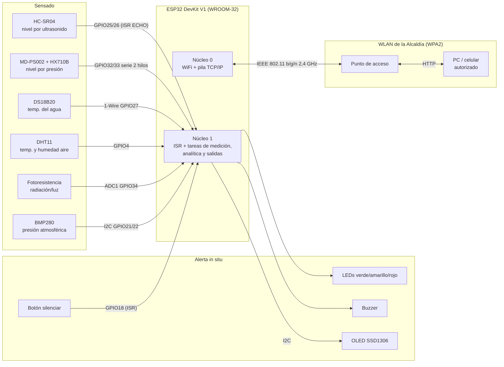
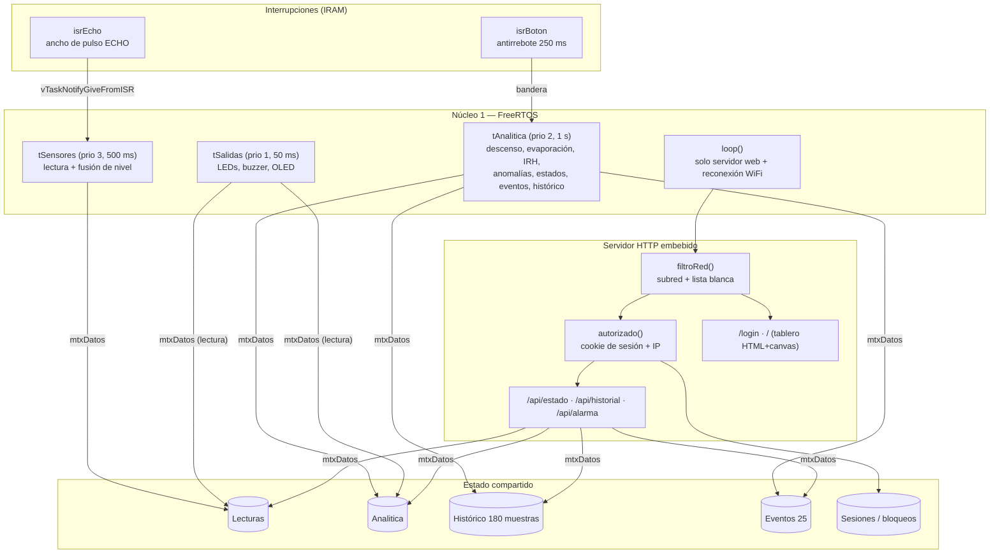
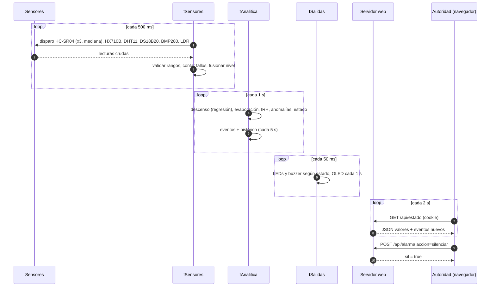

# 2.2. Arquitectura propuesta

La arquitectura sigue los cuatro módulos básicos de un sistema IoT que describen Terán *et al.* [5]: **sensado**, **sistema embebido** (interfaz y procesamiento), **comunicación de datos** y **analítica de datos**. La diferencia con [5] es que aquí el servidor central y el nodo de adquisición son el mismo ESP32. El procesamiento y el tablero corren en el borde (*edge computing*), porque la WLAN de la Alcaldía puede no tener salida a internet.

## 2.2.1. Diagrama de bloques de hardware

## 2.2.2. Diagrama de bloques de software

**Por qué esta separación.** El enunciado exige que la medición no pase por el hilo principal. Con FreeRTOS, además, la carga de la red (que puede bloquear varios milisegundos al atender a un cliente) no altera los periodos de muestreo. La ISR del ECHO mide el ancho del pulso con `esp_timer_get_time()` en microsegundos, en lugar de `pulseIn()`, que es bloqueante. Luego despierta a `tSensores` con una notificación de tarea [8].

**Concurrencia.** Todo acceso a `Lecturas`, `Analitica`, histórico y eventos pasa por el mutex `mtxDatos`. El bus I2C lo comparten la OLED (`tSalidas`) y el BMP280 (`tSensores`), así que tiene su propio mutex `mtxI2C`. Cada tarea copia el estado a variables locales y libera el mutex antes de calcular, para mantener cortas las secciones críticas.

## 2.2.3. Flujo de datos extremo a extremo

## 2.2.4. Seguridad del tablero (3 capas)

| Capa | Mecanismo | Qué detiene |
|---|---|---|
| 1. Red | WPA2 de la WLAN, administrada por la Alcaldía [23] | Dispositivos que no tienen la clave de la red |
| 2. Subred | `(IP_cliente & máscara) == (IP_ESP32 & máscara)`, más una lista blanca opcional con reservas DHCP. Se aplica a **todas** las rutas, incluida `/login`. Los rechazos quedan registrados, como máximo uno cada 30 s por IP | Tráfico enrutado desde otra red y dispositivos no registrados (si la lista blanca está activa) |
| 3. Usuario | Clave guardada como hash SHA-256 [26], comparada en tiempo constante. Token aleatorio de 128 bits (`esp_fill_random`) en una cookie `HttpOnly; SameSite=Strict` [25], atado a la IP del cliente, con expiración de 30 min renovable. Bloqueo de 2 min tras 5 intentos fallidos | Personas dentro de la WLAN sin credenciales, fuerza bruta y robo de sesión desde otra IP |

Además, las respuestas llevan las cabeceras `Cache-Control: no-store`, `X-Frame-Options: DENY`, `X-Content-Type-Options: nosniff` y `Referrer-Policy: no-referrer`, siguiendo [28].

> **Limitación reconocida:** el tablero usa HTTP sin TLS, así que dentro de la WLAN el tráfico viaja sin cifrar a nivel de aplicación. La confidencialidad descansa en el cifrado WPA2 de la capa de enlace. Ver trabajo futuro en [Conclusiones](5.-Conclusiones,-Retos-del-Desarrollo,-Trabajo-Futuro-y-Referencias).

## 2.2.5. Correspondencia con los módulos IoT de [5]

| Módulo IoT [5] | En WaterGuard v8 |
|---|---|
| Sensado | 6 sensores; el nivel tiene 2 fuentes redundantes |
| Agregación de datos | `tSensores` arma la estructura `Lecturas` (análoga a la trama `ID \| RSSI \| HHMMSS` de [5]) |
| Transmisión | HTTP/JSON sobre WiFi (en [5], sockets TCP) |
| Base de datos | Buffers circulares en RAM (histórico y eventos) |
| Visualización y analítica | Tablero embebido + analítica en el borde; análisis offline con K-Means a partir del log CSV ([Anexos](6.-Anexos)) |
