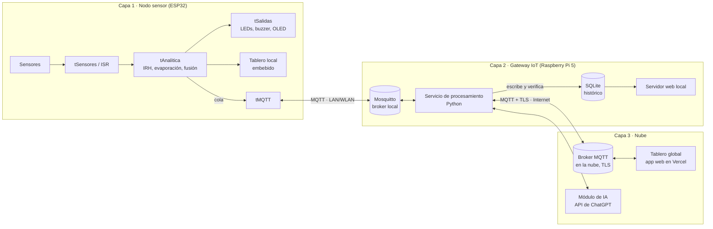
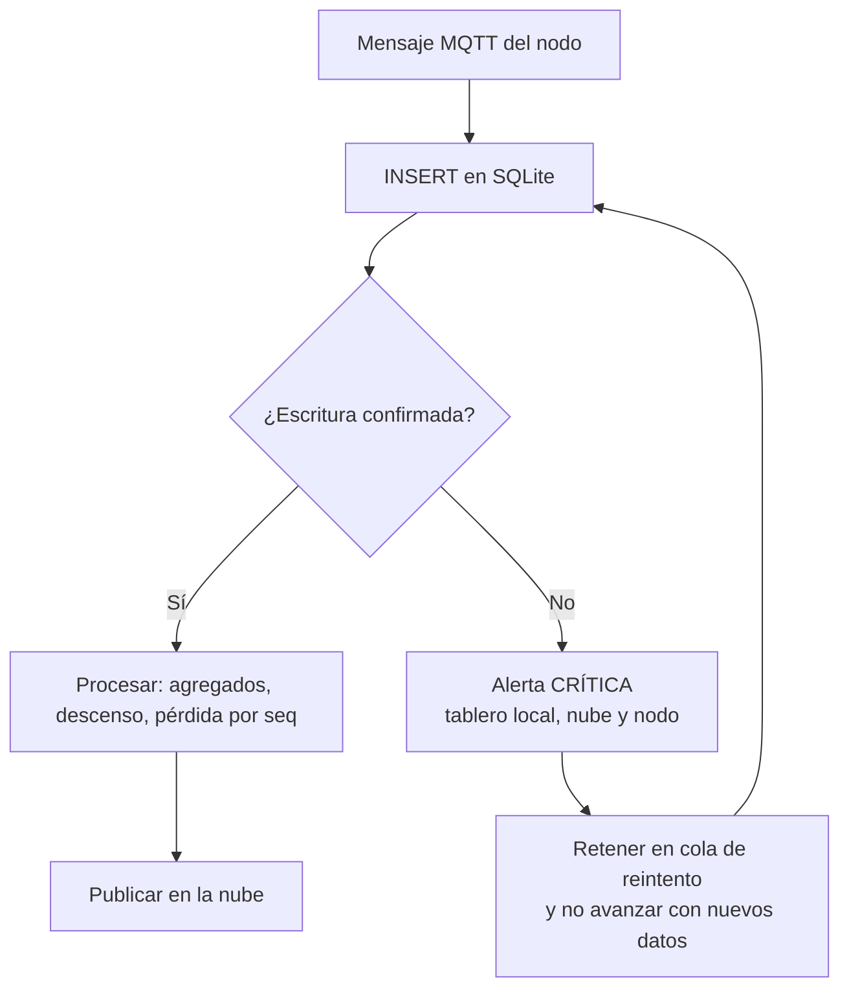
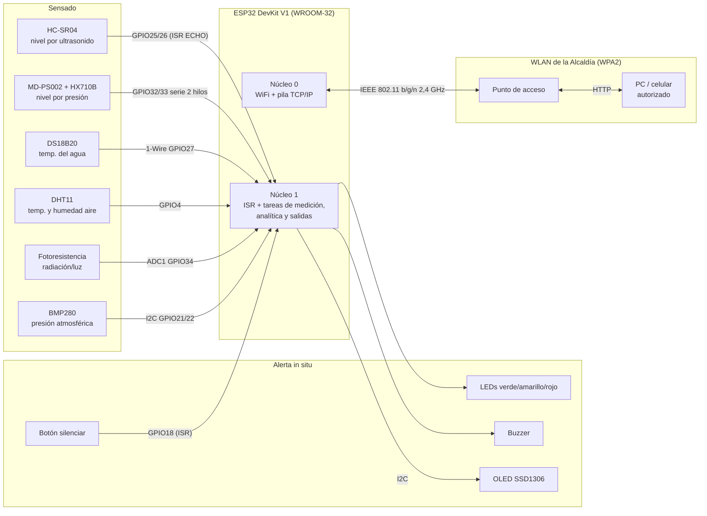
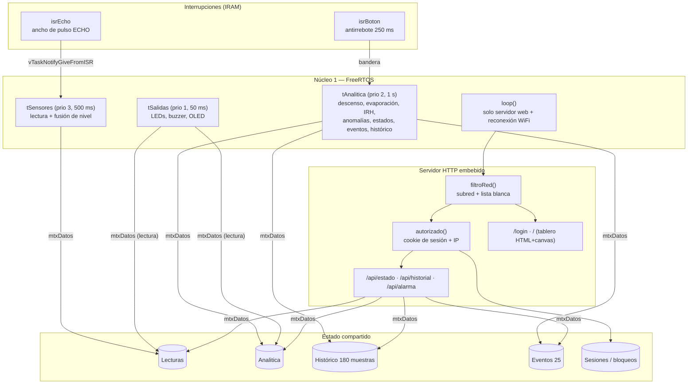
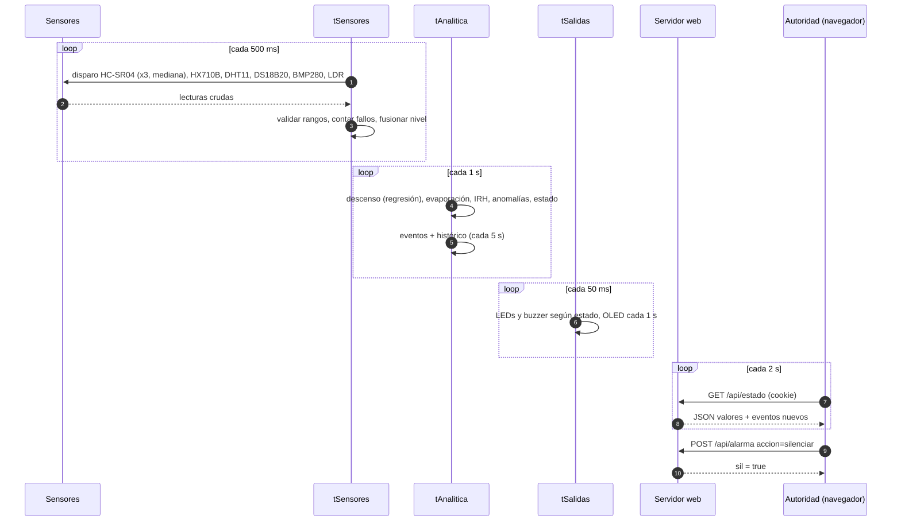

# 2.2. Arquitectura propuesta

La arquitectura sigue los cuatro módulos básicos de un sistema IoT que describen Terán *et al.* [5]: **sensado**, **sistema embebido** (interfaz y procesamiento), **comunicación de datos** y **analítica de datos**. La diferencia con [5] es que aquí el servidor central y el nodo de adquisición son el mismo ESP32. El procesamiento y el tablero corren en el borde (*edge computing*), porque la WLAN de la Alcaldía puede no tener salida a internet.

## 2.2.0. Ecosistema WaterGuard v9 (tres capas)

Las secciones 2.2.1 a 2.2.5 detallan el **nodo sensor** (capa 1). Esta sección describe el ecosistema completo que pide el Challenge #3.

### Componentes y responsabilidades

| Capa | Componente | Responsabilidad |
|---|---|---|
| 1 | **Firmware del ESP32** | El de la v8 más una tarea FreeRTOS `tMQTT`, la única dueña del cliente MQTT. `tAnalitica` le entrega la telemetría por una cola. Si el broker no responde, guarda las muestras en un buffer circular y las reenvía al reconectar. Publica su estado con un mensaje de última voluntad (LWT) |
| 2 | **Broker Mosquitto** | Recibe los mensajes de los nodos por la LAN/WLAN, con usuario y clave por nodo y una lista de control de acceso (ACL) por tópico |
| 2 | **Servicio de procesamiento (Python)** | Se suscribe a `waterguard/+/#`, sella la hora de llegada, guarda cada mensaje en SQLite, calcula agregados (promedios por ventana, tasa de descenso, pérdida de paquetes por `seq`) y solo entonces los reenvía a la nube |
| 2 | **Base de datos local (SQLite)** | Histórico persistente con tablas `telemetria`, `alertas`, `comandos` y `recomendaciones`, en modo WAL e indexadas por nodo y tiempo |
| 2 | **Servidor web local** | Consulta del histórico y del estado de todos los nodos desde la red de la Alcaldía, aunque no haya Internet |
| 3 | **Broker MQTT en la nube** | Punto de entrada de la plataforma IoT: recibe los datos procesados del Gateway por MQTT sobre TLS (puerto 8883) |
| 3 | **Tablero global (Vercel)** | Aplicación web con valor actual, histórico, alertas, notificaciones y botón para silenciar la alarma, accesible desde cualquier parte de Colombia solo con usuario autorizado |
| 3 | **Módulo de IA** | Genera recomendaciones de racionamiento y protección para las autoridades (ver más abajo) |

### Tópicos MQTT (nodo `wg01`)

| Tópico | Dirección | Contenido |
|---|---|---|
| `waterguard/wg01/telemetria` | Nodo → Gateway | JSON con `seq`, nivel (ultrasonido, hidrostático y fusionado), temperaturas, humedad, presión, luz, evaporación e IRH |
| `waterguard/wg01/alerta` | Nodo → Gateway | Cambio de estado (`NORMAL`, `ALERTA`, `CRITICO`, `DEGRADADO`, `ERROR`) y regla que lo disparó |
| `waterguard/wg01/estado` | Nodo → Gateway (retenido) | `online`/`offline` (LWT), IP, tiempo encendido, RSSI y memoria libre |
| `waterguard/wg01/cmd/alarma` | Gateway → Nodo | `{"accion":"silenciar","origen":"tablero-global"}` |
| `waterguard/wg01/ia/recomendacion` | Gateway → Nodo (retenido) | Texto corto de la recomendación y nivel de riesgo previsto |

Los tres canales para silenciar la alarma (botón, tablero local y tablero global) llaman a una sola función `silenciarAlarma(origen)`, que publica el nuevo estado para mantenerlos sincronizados.

### Almacenamiento local con verificación y alerta crítica

El enunciado exige que los datos se **almacenen en una base de datos local y se procesen antes de ir a la plataforma IoT**. El Gateway aplica esta regla en cada mensaje:

Si una escritura falla (disco lleno, base bloqueada o tarjeta SD dañada), el Gateway **emite una alerta crítica antes de seguir llenando datos**. Así ningún dato llega a la nube sin haber quedado primero en el histórico local. Mientras tanto, el nodo sigue alertando in situ, porque su lógica de alarma no depende del Gateway.

### Módulo de IA: recomendación contextualizada

El módulo usa la **API de ChatGPT** (OpenAI) desde el Gateway. Se diseñó para que el modelo no invente cifras y responda siempre con el contexto del punto monitoreado:

1. **Predicción local:** regresión lineal sobre el nivel de los últimos 30–60 min, que estima las horas que faltan para llegar al umbral crítico.
2. **Prompt parametrizado:** un *prompt* de sistema fijo define el rol (apoyo a la decisión de la autoridad local), el formato de salida y las restricciones. En cada petición, el código inserta el contexto real: nodo, municipio, nivel, tendencia, IRH, evaporación, alertas recientes y predicción.
3. **Recuperación de contexto (RAG [57]):** las lecturas y los eventos se guardan en SQLite indexados por nodo y tiempo, junto con resúmenes por ventana. Antes de cada petición se recuperan solo los registros relevantes (por ejemplo, episodios anteriores con un descenso similar), en lugar de enviar todo el histórico. Esto reduce el costo y mejora la pertinencia de la respuesta.
4. **Control de costo y respaldo:** la API solo se llama cuando cambia el estado o cada 15 min. Si no hay Internet o la API falla, se usa una recomendación por reglas. La clave de la API va en una variable de entorno, nunca en el repositorio.
5. **Salida:** la recomendación se guarda en la tabla `recomendaciones` y se publica en el tablero global, en el tablero local y, resumida, en la OLED.

**Por qué IA generativa y no solo reglas:** las reglas de alerta ya existen en el borde (IRH, R1, R2). La IA aporta la traducción de esos indicadores a **decisiones en lenguaje natural** (racionar, proteger la fuente, programar el abastecimiento) para autoridades que no son expertas.

### Seguridad del ecosistema

| Enlace | Mecanismo |
|---|---|
| Nodo ↔ Gateway (LAN/WLAN) | WPA2 de la red, usuario y clave MQTT por nodo y ACL por tópico. Sin TLS por el costo de memoria en el ESP32, compensado con una red cerrada |
| Gateway ↔ nube | MQTT sobre TLS (8883) y autenticación por credenciales o token |
| Tablero global | Acceso solo con usuario autorizado; nunca con un enlace público |
| Credenciales | En variables de entorno y en un `secrets.h` excluido del repositorio |

## 2.2.1. Diagrama de bloques de hardware

## 2.2.2. Diagrama de bloques de software

**Por qué esta separación.** El enunciado exige que la medición no pase por el hilo principal. Con FreeRTOS, además, la carga de la red (que puede bloquear varios milisegundos al atender a un cliente) no altera los periodos de muestreo. La ISR del ECHO mide el ancho del pulso con `esp_timer_get_time()` en microsegundos, en lugar de `pulseIn()`, que es bloqueante. Luego despierta a `tSensores` con una notificación de tarea [8].

**Concurrencia.** Todo acceso a `Lecturas`, `Analitica`, histórico y eventos pasa por el mutex `mtxDatos`. El bus I2C lo comparten la OLED (`tSalidas`) y el BMP280 (`tSensores`), así que tiene su propio mutex `mtxI2C`. Cada tarea copia el estado a variables locales y libera el mutex antes de calcular, para mantener cortas las secciones críticas.

## 2.2.3. Flujo de datos extremo a extremo

## 2.2.4. Seguridad del tablero (3 capas)

| Capa | Mecanismo | Qué detiene |
|---|---|---|
| 1. Red | WPA2 de la WLAN, administrada por la Alcaldía [23] | Dispositivos que no tienen la clave de la red |
| 2. Subred | `(IP_cliente & máscara) == (IP_ESP32 & máscara)`, más una lista blanca opcional con reservas DHCP. Se aplica a **todas** las rutas, incluida `/login`. Los rechazos quedan registrados, como máximo uno cada 30 s por IP | Tráfico enrutado desde otra red y dispositivos no registrados (si la lista blanca está activa) |
| 3. Usuario | Clave guardada como hash SHA-256 [26], comparada en tiempo constante. Token aleatorio de 128 bits (`esp_fill_random`) en una cookie `HttpOnly; SameSite=Strict` [25], atado a la IP del cliente, con expiración de 30 min renovable. Bloqueo de 2 min tras 5 intentos fallidos | Personas dentro de la WLAN sin credenciales, fuerza bruta y robo de sesión desde otra IP |

Además, las respuestas llevan las cabeceras `Cache-Control: no-store`, `X-Frame-Options: DENY`, `X-Content-Type-Options: nosniff` y `Referrer-Policy: no-referrer`, siguiendo [28].

> **Limitación reconocida:** el tablero usa HTTP sin TLS, así que dentro de la WLAN el tráfico viaja sin cifrar a nivel de aplicación. La confidencialidad descansa en el cifrado WPA2 de la capa de enlace. Ver trabajo futuro en [Conclusiones](5.-Conclusiones,-Retos-del-Desarrollo,-Trabajo-Futuro-y-Referencias).

## 2.2.5. Correspondencia con los módulos IoT de [5]

| Módulo IoT [5] | En WaterGuard v8 |
|---|---|
| Sensado | 6 sensores; el nivel tiene 2 fuentes redundantes |
| Agregación de datos | `tSensores` arma la estructura `Lecturas` (análoga a la trama `ID \| RSSI \| HHMMSS` de [5]) |
| Transmisión | HTTP/JSON sobre WiFi (en [5], sockets TCP) |
| Base de datos | Buffers circulares en RAM (histórico y eventos) |
| Visualización y analítica | Tablero embebido + analítica en el borde; análisis offline con K-Means a partir del log CSV ([Anexos](6.-Anexos)) |
