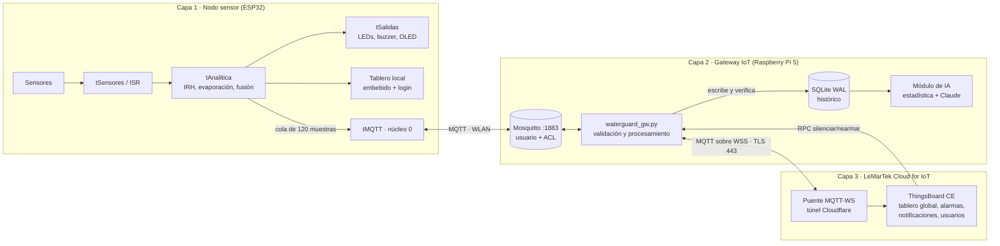
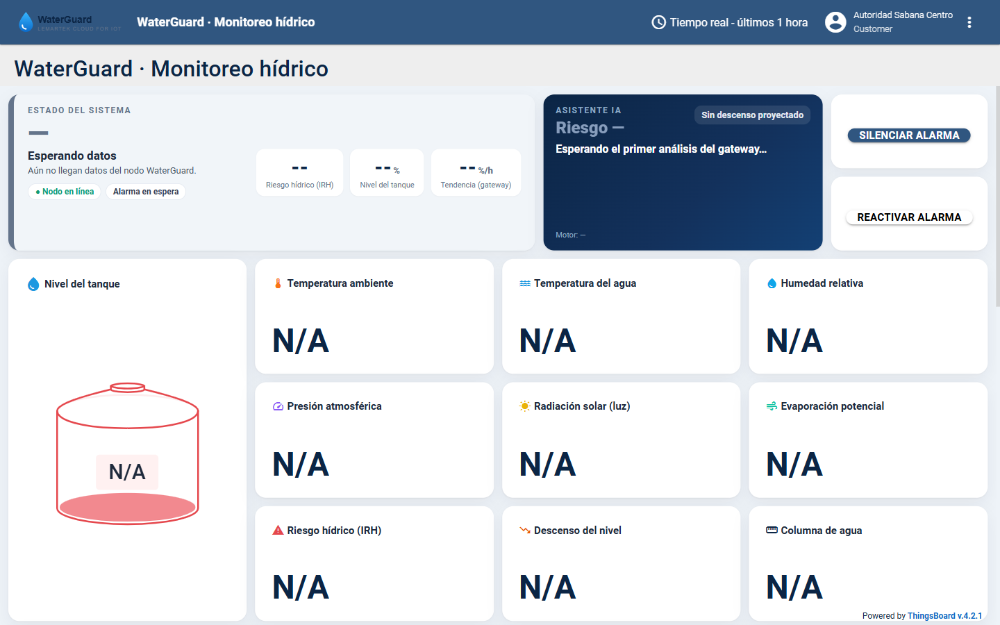
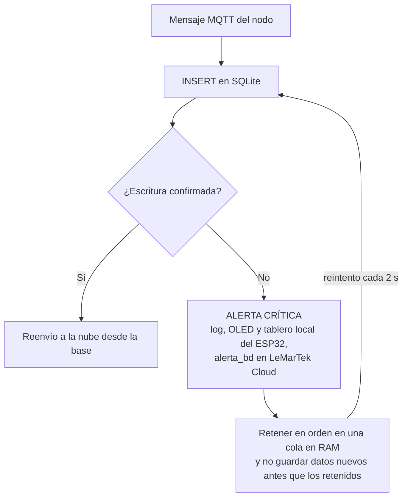
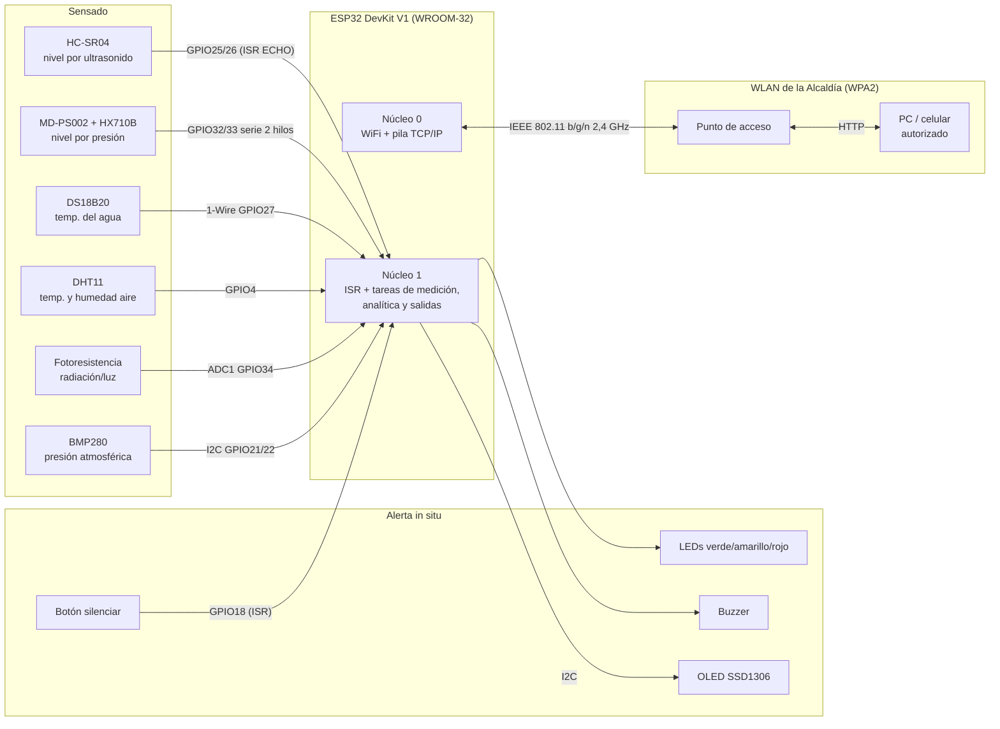
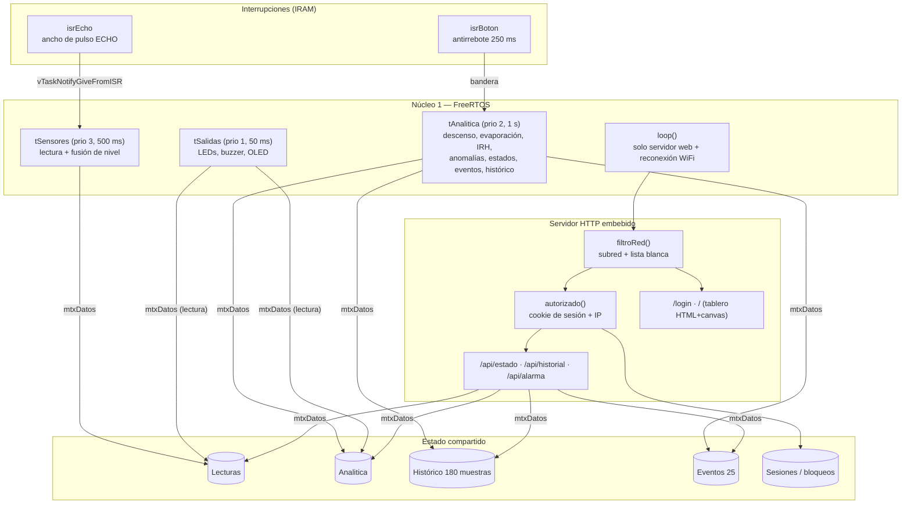
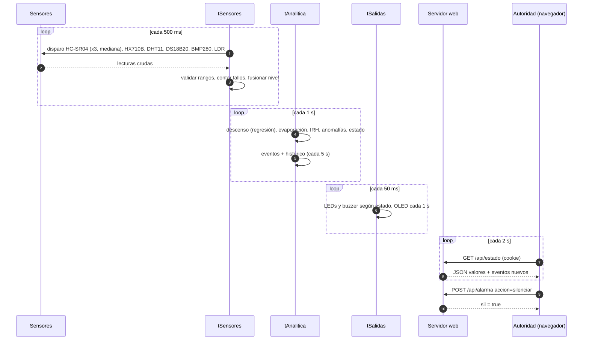

# 2.2. Arquitectura propuesta

La arquitectura sigue los cuatro módulos básicos de un sistema IoT que describen Terán *et al.* [5]: **sensado**, **sistema embebido** (interfaz y procesamiento), **comunicación de datos** y **analítica de datos**. La diferencia con [5] es que aquí el servidor central y el nodo de adquisición son el mismo ESP32. El procesamiento y el tablero corren en el borde (*edge computing*), porque la WLAN de la Alcaldía puede no tener salida a internet.

## 2.2.0. Ecosistema WaterGuard v9 (tres capas)

Las secciones 2.2.1 a 2.2.5 detallan el **nodo sensor** (capa 1). Esta sección describe el ecosistema completo del Challenge #3, tal como quedó implementado en [`codigo/`](https://github.com/Juan100205/IOTPROYECTOFINAL3CORTE/tree/main/codigo).

### Componentes y responsabilidades

| Capa | Componente | Responsabilidad |
|---|---|---|
| 1 | **Firmware del ESP32** ([`WaterGuard_v9.ino`](https://github.com/Juan100205/IOTPROYECTOFINAL3CORTE/blob/main/codigo/WaterGuard_v9/WaterGuard_v9.ino)) | El de la v8 más la tarea FreeRTOS `tMQTT` en el núcleo 0, la única dueña del cliente MQTT (`PubSubClient`). Cada 5 s toma una muestra y la mete en una cola en RAM de 120 muestras (10 min). Si el Gateway no responde, la cola se vacía en orden al reconectar, y el campo `edad_ms` permite reconstruir la hora real de cada medición. Publica su disponibilidad con un mensaje de última voluntad (LWT) |
| 2 | **Broker Mosquitto** ([`mosquitto/`](https://github.com/Juan100205/IOTPROYECTOFINAL3CORTE/tree/main/codigo/raspberry/mosquitto)) | Sin acceso anónimo, con usuario y clave para el nodo y para el Gateway, y una ACL: el nodo solo lee y escribe en `waterguard/nodo1/#` |
| 2 | **Servicio del Gateway** ([`waterguard_gw.py`](https://github.com/Juan100205/IOTPROYECTOFINAL3CORTE/blob/main/codigo/gateway/waterguard_gw.py)) | Se suscribe a los tópicos de los nodos, valida rangos físicos (descarta lo imposible), suaviza el nivel con una media móvil exponencial, calcula la tasa de descenso por regresión de 15 min, guarda todo en SQLite y lo reenvía a la nube desde la base (*store-and-forward*). Corre como servicio `systemd` y la SD de la Raspberry se configura sola en el primer arranque ([`raspberry/`](https://github.com/Juan100205/IOTPROYECTOFINAL3CORTE/tree/main/codigo/raspberry)) |
| 2 | **Base de datos local** ([`basedatos.py`](https://github.com/Juan100205/IOTPROYECTOFINAL3CORTE/blob/main/codigo/gateway/basedatos.py)) | SQLite en modo WAL con las tablas `telemetria`, `eventos`, `estados` e `ia`, indexadas por nodo y tiempo. La columna `enviado` marca lo que la nube ya confirmó |
| 2 | **Módulo de IA** ([`ia_claude.py`](https://github.com/Juan100205/IOTPROYECTOFINAL3CORTE/blob/main/codigo/gateway/ia_claude.py)) | Predicción, detección de anomalías y recomendación (ver más abajo) |
| 3 | **LeMarTek Cloud for IoT** | Plataforma en la nube del equipo: ThingsBoard CE en Docker sobre un servidor propio, publicado solo por un túnel de Cloudflare (no abre puertos). Recibe los datos por MQTT sobre WebSockets seguros |
| 3 | **Tablero global** (`https://iot.lemartek.cloud`) | Estado del sistema, nivel del tanque, 9 tarjetas de variables, gráficas históricas, tarjeta del asistente de IA, tabla de alarmas, bitácora de eventos y botones para silenciar y reactivar la alarma. Accesible desde cualquier parte de Colombia solo con usuario autorizado |

|  |
|---|
| **Figura 20.** Tablero global en LeMarTek Cloud, visto con el rol "Autoridad Sabana Centro". Captura del 10 de noviembre de 2026 a las 00:22, con el nodo en línea pero sin datos recibidos en la última hora. |

### Tópicos MQTT (nodo `nodo1`)

| Tópico | Dirección | Contenido |
|---|---|---|
| `waterguard/nodo1/telemetria` | Nodo → Gateway | Lecturas cada 5 s: `seq`, `edad_ms`, nivel (fusionado, ultrasónico e hidrostático), temperaturas, humedad, presión, luz, evaporación, DPV, descenso, IRH, estado y reglas activas |
| `waterguard/nodo1/estado` | Nodo → Gateway (retenido) | Estado, IRH y estado de la alarma; al cambiar o cada 60 s |
| `waterguard/nodo1/eventos` | Nodo → Gateway | Cambios de estado, fallas de sensores y alarma silenciada |
| `waterguard/nodo1/disponible` | Nodo → Gateway (LWT, retenido) | `online` / `offline` |
| `waterguard/nodo1/cmd` | Gateway → Nodo | `{"accion":"silenciar"|"rearmar","origen":...}` |
| `waterguard/nodo1/ia` | Gateway → Nodo (retenido) | Horas hasta el nivel crítico, riesgo y recomendación corta (se muestra en el tablero local y en la OLED) |

Hacia la nube, el Gateway publica en `v1/devices/me/telemetry` (API MQTT de ThingsBoard) y recibe por RPC las órdenes del tablero global (`silenciarAlarma`, `rearmarAlarma`, `setAlarma`). Así, el botón del tablero global recorre **ThingsBoard → Gateway → MQTT `cmd` → ESP32**, y los tres canales (botón físico, tablero local y tablero global) quedan sincronizados.

### Almacenamiento local con verificación y alerta crítica

El enunciado exige que los datos se **almacenen en una base de datos local y se procesen antes de ir a la plataforma IoT**. En el Gateway, la nube solo recibe filas que ya están en SQLite, y cada escritura se verifica:

Si una escritura falla (disco lleno, base bloqueada o tarjeta SD dañada), el Gateway **emite una alerta crítica antes de seguir llenando datos**:

- En el ESP32 aparece "FALLA BD GATEWAY: datos retenidos, revisar la SD" con riesgo crítico, en la OLED y en el tablero local.
- En la nube se publica `alerta_bd = true` con el detalle del error, para que una regla de alarma de ThingsBoard notifique a las autoridades.
- Las escrituras quedan retenidas **en orden** (hasta 5000, ≈ 7 h de telemetría) y se reintentan cada 2 s.

Cuando la base se recupera, se guardan todas las escrituras retenidas, se apaga la alerta y se restablece la última recomendación de la IA. La prueba automatizada [`prueba_alerta_bd.py`](https://github.com/Juan100205/IOTPROYECTOFINAL3CORTE/blob/main/codigo/gateway/pruebas/prueba_alerta_bd.py) verifica este comportamiento (prueba P3, [sección 4](4.-Autoevaluación-del-Protocolo-de-Pruebas)). Mientras tanto, el nodo sigue alertando in situ, porque su lógica de alarma no depende del Gateway.

### Módulo de IA: predicción, anomalías y recomendación con Claude

El módulo corre en el Gateway y tiene dos capas, para que el sistema **nunca quede sin predicción**:

1. **Base estadística local** (sin Internet): regresión lineal del nivel en la última hora, que estima las horas hasta el umbral crítico. También sirve de referencia para la IA.
2. **Claude** (API de Anthropic, modelo `claude-opus-5-5`, SDK oficial de Python): recibe un *prompt* de sistema fijo con el contexto del problema (tanque en Sabana Centro, El Niño, lectores no expertos) y, en cada petición, **los datos reales recuperados de la base local**:
   - el resumen por minuto de las últimas 2 h (consulta indexada por nodo y tiempo);
   - los eventos recientes;
   - la estimación estadística y los datos del tanque (capacidad y umbral crítico).

   Responde con **salida estructurada** validada contra un esquema JSON: `riesgo` (bajo, medio, alto o crítico) y `horas_hasta_critico` (**predicción**); `anomalia` y `tipo_anomalia`, como fuga, consumo excesivo o sensor congelado (**detección de anomalías**); y `recomendacion` (máximo 120 caracteres, para la OLED), `acciones` y `explicacion` (**recomendación**).

Este patrón de recuperar el contexto de la base local antes de cada petición sigue la idea de la generación aumentada por recuperación (RAG) [57]: el modelo razona sobre cifras medidas y no inventa datos.

**Cuándo se ejecuta:** cada 15 min y, de inmediato, cuando el nodo entra en `ALERTA` o `CRITICO` (máximo un análisis extra cada 3 min). **Robustez:** si no hay clave de API, no hay Internet o la llamada falla, se usa la base estadística. Si el modelo rechaza la solicitud, el *fallback* del servidor la reintenta con otro modelo. **Salida:** el resultado se guarda en la tabla `ia`, se publica en la tarjeta del asistente de IA de LeMarTek Cloud (que dispara la alarma "IA: riesgo alto") y llega al ESP32 por `waterguard/nodo1/ia`. Cada análisis cuesta del orden de USD 0,02.

**Por qué IA generativa y no solo reglas:** las reglas de alerta ya existen en el borde (IRH, R1, R2). La IA aporta la **traducción de esos indicadores a decisiones en lenguaje natural** (racionar por horarios, inspeccionar fugas, avisar a la comunidad) para autoridades que no son expertas, y corrige la regresión cuando el descenso se acelera o se frena.

### Seguridad del ecosistema

| Enlace o componente | Mecanismo |
|---|---|
| Nodo ↔ Gateway (WLAN) | WPA2 de la red, usuario y clave MQTT por nodo y ACL por tópico. Sin TLS dentro de la WLAN, por el costo de memoria en el ESP32 |
| Gateway ↔ nube | MQTT sobre WebSockets con TLS (puerto 443) a través del túnel de Cloudflare, con usuario y clave del puente. El token del dispositivo de ThingsBoard queda solo en el servidor |
| Tablero global | Usuarios por rol: administrador LeMarTek y autoridad de la Alcaldía (solo ve su tablero). Claves de mínimo 12 caracteres, bloqueo tras 5 intentos y doble factor (TOTP). Nunca hay un enlace público |
| Tablero local | Las 3 capas de la v8 (2.2.4) |
| Credenciales | En `waterguard.env` y en el firmware con valores de ejemplo. Los archivos reales están excluidos del repositorio (`.gitignore`) |

### Tecnologías por componente

**Tablero local (en el ESP32)**

| Capa | Tecnología |
|---|---|
| Servidor | `WebServer` del núcleo Arduino-ESP32, en el propio microcontrolador [41] |
| Interfaz | HTML, CSS y JavaScript embebidos en el firmware. Las gráficas se dibujan en `<canvas>`, sin librerías externas, para que funcionen sin Internet |
| Datos | API REST en JSON: `/api/estado`, `/api/historial` y `/api/alarma`, consultada cada 2 s [24] |
| Seguridad | Filtro de subred, login con hash SHA-256 (mbedTLS) [26], [48], cookie de sesión `HttpOnly` atada a la IP [25] y bloqueo tras 5 intentos |
| Descubrimiento | mDNS: `http://waterguard.local` [39] |
| Mensajería | `PubSubClient` para MQTT [71] y `ArduinoJson` para los mensajes [72] |

**Tablero global: LeMarTek Cloud for IoT**

| Capa | Tecnología |
|---|---|
| Plataforma IoT | ThingsBoard Community Edition 4.2.1, de código abierto (Apache 2.0), con backend en Java/Spring y frontend en Angular [63] |
| Base de datos | PostgreSQL para las series de tiempo, con retención de 90 días [64] |
| Despliegue | Docker Compose en un servidor propio de LeMarTek (nube privada autoalojada) [65] |
| Entrada MQTT | Mosquitto 2.0.20 como puente MQTT sobre WebSockets hacia ThingsBoard [60], [66] |
| Publicación segura | Cloudflare Tunnel: TLS (HTTPS y WSS) sin abrir puertos en el servidor [67] |
| Configuración | Scripts en Python sobre la API REST de ThingsBoard, que crean el dispositivo, el tablero, las 5 alarmas, las notificaciones y los usuarios |
| Seguridad | Roles (administrador y autoridad), contraseñas de 12 o más caracteres, bloqueo tras 5 intentos y doble factor (TOTP) |

**Gateway (Raspberry Pi 5)**

| Capa | Tecnología |
|---|---|
| Sistema operativo | Raspberry Pi OS Trixie (64 bits), configurado en el primer arranque con cloud-init |
| Broker local | Mosquitto, con usuarios, clave y ACL [66] |
| Servicio | Python 3.13 con `paho-mqtt` 2.2 [69], ejecutado como servicio `systemd` |
| Base de datos | SQLite en modo WAL, que permite leer mientras se escribe [68] |
| Inteligencia artificial | SDK oficial de Anthropic para Claude, con salida estructurada en JSON [70] |
| Descubrimiento | Avahi (mDNS): el nodo encuentra el Gateway como `waterguard-gw.local` |

## 2.2.1. Diagrama de bloques de hardware

## 2.2.2. Diagrama de bloques de software

**Por qué esta separación.** El enunciado exige que la medición no pase por el hilo principal. Con FreeRTOS, además, la carga de la red (que puede bloquear varios milisegundos al atender a un cliente) no altera los periodos de muestreo. La ISR del ECHO mide el ancho del pulso con `esp_timer_get_time()` en microsegundos, en lugar de `pulseIn()`, que es bloqueante. Luego despierta a `tSensores` con una notificación de tarea [8].

**Concurrencia.** Todo acceso a `Lecturas`, `Analitica`, histórico y eventos pasa por el mutex `mtxDatos`. El bus I2C lo comparten la OLED (`tSalidas`) y el BMP280 (`tSensores`), así que tiene su propio mutex `mtxI2C`. Cada tarea copia el estado a variables locales y libera el mutex antes de calcular, para mantener cortas las secciones críticas.

## 2.2.3. Flujo de datos extremo a extremo

## 2.2.4. Seguridad del tablero (3 capas)

| Capa | Mecanismo | Qué detiene |
|---|---|---|
| 1. Red | WPA2 de la WLAN, administrada por la Alcaldía [23] | Dispositivos que no tienen la clave de la red |
| 2. Subred | `(IP_cliente & máscara) == (IP_ESP32 & máscara)`, más una lista blanca opcional con reservas DHCP. Se aplica a **todas** las rutas, incluida `/login`. Los rechazos quedan registrados, como máximo uno cada 30 s por IP | Tráfico enrutado desde otra red y dispositivos no registrados (si la lista blanca está activa) |
| 3. Usuario | Clave guardada como hash SHA-256 [26], comparada en tiempo constante. Token aleatorio de 128 bits (`esp_fill_random`) en una cookie `HttpOnly; SameSite=Strict` [25], atado a la IP del cliente, con expiración de 30 min renovable. Bloqueo de 2 min tras 5 intentos fallidos | Personas dentro de la WLAN sin credenciales, fuerza bruta y robo de sesión desde otra IP |

Además, las respuestas llevan las cabeceras `Cache-Control: no-store`, `X-Frame-Options: DENY`, `X-Content-Type-Options: nosniff` y `Referrer-Policy: no-referrer`, siguiendo [28].

> **Limitación reconocida:** el tablero usa HTTP sin TLS, así que dentro de la WLAN el tráfico viaja sin cifrar a nivel de aplicación. La confidencialidad descansa en el cifrado WPA2 de la capa de enlace. Ver trabajo futuro en [Conclusiones](5.-Conclusiones,-Retos-del-Desarrollo,-Trabajo-Futuro-y-Referencias).

## 2.2.5. Correspondencia con los módulos IoT de [5]

| Módulo IoT [5] | En WaterGuard v8 |
|---|---|
| Sensado | 6 sensores; el nivel tiene 2 fuentes redundantes |
| Agregación de datos | `tSensores` arma la estructura `Lecturas` (análoga a la trama `ID \| RSSI \| HHMMSS` de [5]) |
| Transmisión | HTTP/JSON sobre WiFi (en [5], sockets TCP) |
| Base de datos | Buffers circulares en RAM (histórico y eventos) |
| Visualización y analítica | Tablero embebido + analítica en el borde; análisis offline con K-Means a partir del log CSV ([Anexos](6.-Anexos)) |
