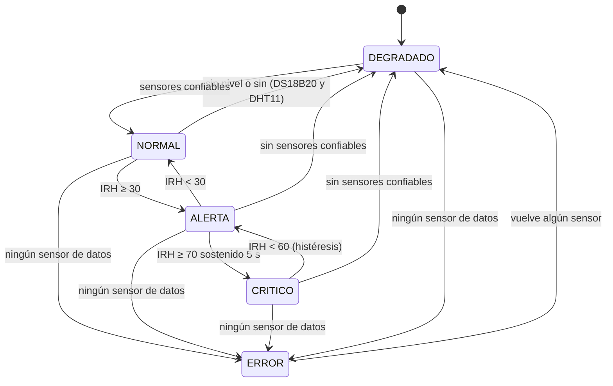

# 2.3. Desarrollo teórico modular y criterios de diseño

Esta página explica **de dónde sale cada fórmula, peso y umbral** del firmware, y con qué referencia se justifica. Los nombres de constantes corresponden a `WaterGuard_v8.ino`.

## 2.3.1. Criterios de diseño

| # | Criterio | Consecuencia en el diseño |
|---|---|---|
| C1 | **Alertas válidas antes que alertas rápidas** | Ninguna variable dispara sola el estado `CRITICO`: se exige IRH ≥ 70 sostenido durante 5 s, con histéresis de salida en 60 |
| C2 | **Redundancia en la variable principal** (nivel) | Dos principios físicos independientes. Si discrepan, se toma el menor (criterio conservador ante sequía) [6], [20] |
| C3 | **Degradación elegante** | Los índices se normalizan solo sobre los sensores que responden, y la falla de uno no anula el cálculo |
| C4 | **Indicadores con base física** | La evaporación usa la ley de Dalton y la ecuación de Tetens [9], [11], [13], no pesos arbitrarios |
| C5 | **Independencia de la red** | La alerta in situ funciona aunque el WiFi caiga |
| C6 | **Trazabilidad** | Toda transición de estado, falla de sensor, acceso y acción sobre la alarma genera un evento; el Serial emite una línea CSV `LOG,...` |

## 2.3.2. Módulo de nivel de agua (fusión de dos fuentes)

El nivel de almacenamiento es el indicador directo de disponibilidad hídrica. De la Portilla *et al.* [16] validan un indicador IoT de nivel en tanques como base para la gestión del riego. Aquí el nivel se mide de dos formas.

### a) Ultrasonido (HC-SR04), desde la tapa

La distancia sale del tiempo de vuelo del eco. Con la velocidad del sonido *c* ≈ 343 m/s (aire a unos 20 °C), el trayecto es de ida y vuelta:

$$d\,[\text{cm}] = \frac{t_{eco}\,[\mu s]\cdot 0{,}0343}{2} \approx \frac{t_{eco}}{58{,}2}$$

$$N_{US} = \mathrm{clamp}\!\left(\frac{H_{tanque}-d}{H_{tanque}}\cdot 100,\;0,\;100\right)\ [\%]$$

- `t_eco` lo mide la **ISR** `isrEcho` con `esp_timer_get_time()`, con resolución de 1 µs [8].
- En cada ciclo se toman 3 disparos y se usa la **mediana**, que filtra ecos sueltos sin el retardo de un promedio largo.
- Las lecturas fuera de [2, 400] cm se descartan; tras 3 fallos seguidos (`MAX_FALLOS`), el sensor se marca como no confiable.

### b) Presión hidrostática (MD-PS002 + HX710B), en el fondo

La presión en el fondo de una columna de líquido es $P = \rho g h$. Con $\rho = 1000$ kg/m³ y $g = 9{,}80665$ m/s², 1 cm de agua equivale a 98,0665 Pa:

$$h\,[\text{cm}] = \frac{P\,[\text{Pa}]}{98{,}0665}, \qquad P\,[\text{kPa}] = \frac{\text{crudo}-\text{offset}}{K_{HX}}$$

- `offset` es la **tara automática**: el promedio de 15 lecturas al arrancar, con la manguera fuera del agua. Así la presión atmosférica local se cancela.
- `K_HX = HX_CUENTAS_POR_KPA` se calibra con dos puntos (en el aire y a una profundidad conocida *H*):
  $K_{HX} = \dfrac{\text{crudo}_{sumergido}-\text{crudo}_{aire}}{H \cdot 0{,}0980665}$
- A diferencia del ultrasonido, este sensor no se ve afectado por espuma, condensación en la tapa o la temperatura del aire. Por eso es un buen complemento.

### c) Regla de fusión

$$
N =
\begin{cases}
\dfrac{N_{US}+N_P}{2} & \text{si ambos válidos y } |N_{US}-N_P| \le 10\,\% \\[4pt]
\min(N_{US},\,N_P) \;+\; \text{evento de discrepancia} & \text{si ambos válidos y } |N_{US}-N_P| > 10\,\% \\[4pt]
\text{la fuente válida} & \text{si solo una responde} \\
\text{sin dato} & \text{si ninguna responde}
\end{cases}
$$

**Justificación.** Khaleghi *et al.* [6] clasifican la fusión según la relación entre las fuentes. Aquí hay fusión **redundante** (dos sensores miden la misma variable) para aumentar la confiabilidad y detectar fallas. Promediar dos medidas concordantes reduce la varianza del error; cuando no concuerdan, promediar escondería la falla. En ese caso se elige el valor más desfavorable para la seguridad hídrica, criterio que Durrant-Whyte y Henderson [20] describen como resolver el conflicto con conocimiento del dominio. La tolerancia de 10 % (`TOLERANCIA_NIVEL`) absorbe la resolución del HC-SR04 (≈0,3 cm) y la deriva térmica del HX710B en un tanque de 100 cm.

## 2.3.3. Tasa de descenso del nivel (%/min)

Detectar un **descenso anómalo** (fuga, consumo excesivo o evaporación acelerada) es tan importante como el nivel absoluto [22]. La pendiente se estima por **mínimos cuadrados** sobre los últimos 60 s (30 muestras cada 2 s, mínimo 8):

$$m = \frac{n\sum x_i y_i - \sum x_i \sum y_i}{n\sum x_i^2 - \left(\sum x_i\right)^2}\ [\%/s], \qquad D = -60\,m\ [\%/\text{min}]$$

*D* > 0 significa que el nivel **baja**. La regresión es menos sensible al ruido que la diferencia entre dos muestras, porque usa toda la ventana [10]. Si falta una lectura de nivel, el buffer se reinicia para no ajustar una recta sobre un hueco.

| Umbral | Valor en el prototipo | Uso |
|---|---|---|
| `UMBRAL_DESCENSO` | 1 %/min | Descenso anómalo: suma 10 puntos al IRH y habilita la regla R1 |
| `UMBRAL_DESCENSO_CRIT` | 3 %/min | Descenso crítico: suma 20 puntos al IRH |

> Estos umbrales están **escalados** para que el banco de pruebas muestre el evento en minutos. En un reservorio real el descenso se mide en %/día y los umbrales se recalibran con el histórico del punto.

## 2.3.4. Índice de evaporación potencial (0-100)

### a) Presión de vapor de saturación — ecuación de Tetens

$$e^{\circ}(T) = 0{,}6108\,\exp\!\left(\frac{17{,}27\,T}{T+237{,}3}\right)\ [\text{kPa}],\quad T\ \text{en °C}$$

Es la forma que adopta la FAO en el manual 56 (ec. 11) [9]. Huang, Abolt y Bennett [11] analizan cómo la elección de la fórmula de presión de vapor de saturación afecta los resultados de un modelo hidrotermal, lo que muestra que es una decisión de diseño y no un detalle. Se eligió Tetens porque es la forma recomendada por la FAO [9] y porque en un microcontrolador cuesta una sola exponencial, sin tablas.

### b) Presión de vapor real y déficit de presión de vapor (DPV)

$$e_a = e^{\circ}(T_{aire})\cdot\frac{HR}{100}, \qquad DPV = \max\!\big(0,\; e^{\circ}(T_{sup}) - e_a\big)$$

- $e_a$ sale de la humedad relativa del DHT11, como en la FAO-56 (ec. 19, forma simplificada) [9].
- $T_{sup}$ es la **temperatura del agua** (DS18B20) cuando está disponible; si no, la del aire. Usar la del agua es más fiel a Dalton, porque lo que evapora es la superficie del líquido.
- Verduzco-Grajeda *et al.* [12] estiman el DPV en regiones vitivinícolas de México como variable climática de interés agrícola. La lógica es la misma que aquí: a mayor DPV, mayor poder evaporante del aire.

### c) Ley de Dalton

Dalton establece que la tasa de evaporación de una superficie de agua es proporcional a la diferencia de presiones de vapor y a una función del viento [13]:

$$E = f(u)\,\big(e^{\circ}(T_{sup}) - e_a\big)$$

El prototipo no tiene anemómetro, así que $f(u)$ no se mide. Por eso el resultado es un **índice relativo**, no una tasa en mm/día. Serio [13] usa este modelo como el término aerodinámico dentro de un modelo suelo-planta-atmósfera.

### d) Composición del índice

$$I_{evap} = 100\cdot\frac{\sum_i w_i\, s_i}{\sum_i w_i}\quad(\text{solo sensores disponibles})$$

| Componente $s_i$ (0-100) | Fórmula | Peso $w_i$ | Justificación |
|---|---|---|---|
| Déficit de vapor | $\min(DPV/2\ \text{kPa},1)\cdot100$ | 45 | Término de Dalton; motor principal de la evaporación [9], [13]. 2 kPa corresponde a un aire muy seco para la Sabana |
| Radiación (luminosidad) | lectura ADC normalizada | 30 | La radiación aporta la energía del cambio de fase. El enunciado cita el aumento de evaporación por radiación solar [1]; ver también [15], [17]. Pretorius y Loots [40] identifican la temperatura y la radiación solar entre los factores de mayor peso en la evaporación de cuerpos de agua abiertos |
| Temperatura del aire | $\min(T_{aire}/35,1)\cdot100$ | 15 | Monterroso-Rivas y Gómez-Díaz [15] estudian el impacto del aumento de temperatura por cambio climático sobre la evapotranspiración potencial |
| Presión atmosférica | $\mathrm{clamp}\!\big((1013-P)/313\big)\cdot100$ | 10 | A menor presión, el vapor escapa con más facilidad (la constante psicrométrica es proporcional a *P*) [9], [19] |

Categorías: **BAJA** < 30 ≤ **MEDIA** < 60 ≤ **ALTA**.

**Sobre la presión en la Sabana.** Con la ec. 7 de la FAO-56 [9], a 2600 m de altitud: $P = 101{,}3\left(\frac{293-0{,}0065\cdot2600}{293}\right)^{5{,}26} \approx 74\ \text{kPa} = 740\ \text{hPa}$. Ahí el término de presión aporta casi constante y **baja cuando entra un frente húmedo**, que es justo la información útil. Guallpa y Célleri [19] estudian el efecto de *estimar* la presión atmosférica, en lugar de medirla, sobre el cálculo de niveles de agua con sensores de presión. Por eso se mide con el BMP280 en lugar de suponerla. El mismo argumento justifica la tara del MD-PS002 (§2.3.2b), que cancela la presión atmosférica local.

## 2.3.5. Índice de Riesgo Hídrico — IRH (0-100)

El IRH adapta a un solo punto de almacenamiento la idea de los índices de riesgo al recurso hídrico de la Evaluación Regional del Agua (ERA), que combinan **amenaza** (oferta decreciente, presión climática) y **vulnerabilidad** del sistema [14]. Cada variable aporta puntos según su nivel de peligro y el total se normaliza sobre las variables disponibles:

$$IRH_{base} = 100\cdot\frac{\sum_i p_i}{\sum_i p_i^{max}}$$

| Variable | Peso máx. | Puntos | Justificación |
|---|---|---|---|
| Nivel *N* | 40 | < 15 % → 40 · < 30 % → 25 · > 95 % → 15 (rebose) | Indicador directo de disponibilidad [16]; es el de mayor peso |
| Descenso *D* | 20 | ≥ 3 %/min → 20 · ≥ 1 %/min → 10 | Anticipa el agotamiento antes de llegar a nivel bajo [22] |
| Evaporación | 15 | ALTA → 15 · MEDIA → 7 | Pérdida no controlable por el usuario [9], [15] |
| Humedad relativa | 15 | < 35 % → 15 · < 50 % → 7 | Aire seco, condición de sequía meteorológica. Ruiz-Ochoa *et al.* [18] usan la HR junto con la precipitación y la temperatura para la gestión hídrica en Casanare |
| Temperatura del agua | 10 | ≥ 28 °C → 10 · ≥ 24 °C → 5 | El agua caliente evapora más y señala exposición directa al sol. Bravo *et al.* [17] documentan la relación entre radiación solar y temperatura ambiente |

### Reglas de fusión (conocimiento experto)

Se suman **después** de normalizar, porque representan combinaciones más graves que la suma de sus partes. Es fusión de decisiones en el sentido de [6]:

| Regla | Condición | Aporte | Origen |
|---|---|---|---|
| **R1** | $D \ge 1\ \%/min$ **y** calor ($T_{aire} \ge 26$ °C **o** evaporación ALTA) | +20 | Evento que pide detectar el enunciado: *"tasas anómalas de descenso de nivel bajo condiciones de calor extremo"* |
| **R2** | $N < 30\ \%$ **y** evaporación ALTA | +10 | Reserva baja que además se está perdiendo por evaporación |

El umbral de calor de 26 °C es alto para la Sabana, donde las temperaturas medias rondan los 13-15 °C. Se eligió así para que el banco de pruebas (bombillo halógeno) lo cruce de forma deliberada. En campo se recomienda fijarlo como percentil alto de la serie histórica local.

### Anomalías estadísticas

$$\text{anómala} \iff |x_t - \mu_W| > 2\,\max(\sigma_W,\,2)$$

- Ventana móvil *W* de 10 valores del $IRH_{base}$, con al menos 3 muestras.
- La regla de 2σ es el límite clásico de alerta de un gráfico de control, y el puntaje z sobre ventana móvil es una de las técnicas livianas recomendadas para detectar anomalías en el borde con nodos IoT de pocos recursos [37]. Rodríguez Tocagón [21] aplica gráficos de control a series meteorológicas y climáticas para detectar anomalías. El piso $\sigma \ge 2$ evita que un IRH muy estable convierta cualquier variación mínima en anomalía.
- Un contador con fuga (+1 si hay anomalía, −1 si no, máximo 4) suma **5 puntos por anomalía** al IRH. Así, una anomalía aislada pesa poco y una racha pesa más.

$$IRH = \mathrm{clamp}\big(IRH_{base} + 20\,R1 + 10\,R2 + 5\,k_{anom},\ 0,\ 100\big)$$

## 2.3.6. Máquina de estados

| Estado | Condición | LEDs | Buzzer |
|---|---|---|---|
| `NORMAL` | IRH < 30 | Verde | Apagado |
| `ALERTA` | 30 ≤ IRH, o verificando un posible crítico | Amarillo | Apagado |
| `CRITICO` | IRH ≥ 70 durante 5 s; se mantiene mientras IRH ≥ 60 | Rojo | Encendido |
| `DEGRADADO` | Falta el nivel, o faltan ambos sensores de temperatura | Amarillo intermitente (600 ms) | Apagado |
| `ERROR` | Ningún sensor de datos responde | Rojo intermitente (250 ms) | Intermitente |

**Por qué 5 s de confirmación y 10 puntos de histéresis.** Evitan el "parpadeo" de la alarma cuando el IRH oscila alrededor del umbral. Exigir persistencia antes de declarar un evento reduce los falsos positivos por ruido puntual, un problema central en la detección de anomalías en series de tiempo de datos del agua [22]. El silencio de la alarma se rearma solo al salir de `CRITICO`/`ERROR` o a los 10 minutos, para que una alarma silenciada no quede olvidada.

## 2.3.7. Tabla resumen de parámetros

| Constante | Valor | Sección |
|---|---|---|
| `ALTURA_TANQUE` | 100 cm | 2.3.2 |
| `TOLERANCIA_NIVEL` | 10 % | 2.3.2 |
| `UMBRAL_DESCENSO` / `_CRIT` | 1 / 3 %/min | 2.3.3 |
| `EVAP_MEDIA` / `EVAP_ALTA` | 30 / 60 | 2.3.4 |
| `HUMEDAD_BAJA` / `_MEDIA` | 35 / 50 % | 2.3.5 |
| `T_AGUA_MEDIA` / `_ALTA` | 24 / 28 °C | 2.3.5 |
| `T_AMB_CALOR` | 26 °C | 2.3.5 (R1) |
| `UMBRAL_ALERTA` / `_CRITICO` / `_SALIDA_CRITICO` | 30 / 70 / 60 | 2.3.6 |
| `TIEMPO_CONFIRMACION_CRITICO` | 5 s | 2.3.6 |
| `TAM_VENTANA_ANOMALIA` / `UMBRAL_DESVIACIONES` | 10 / 2σ | 2.3.5 |
| `SILENCIO_MAX_MS` | 10 min | 2.3.6 |
| Periodos de tareas | 500 ms / 1 s / 50 ms | [Arquitectura](2.2.-Arquitectura-Propuesta) |
