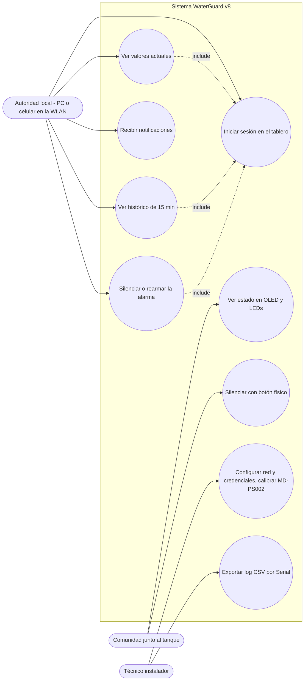
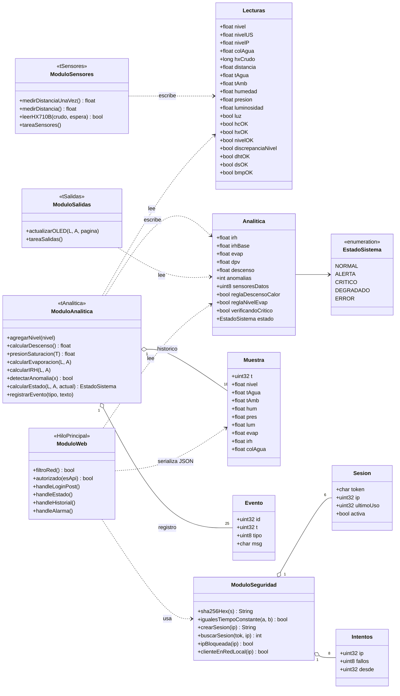
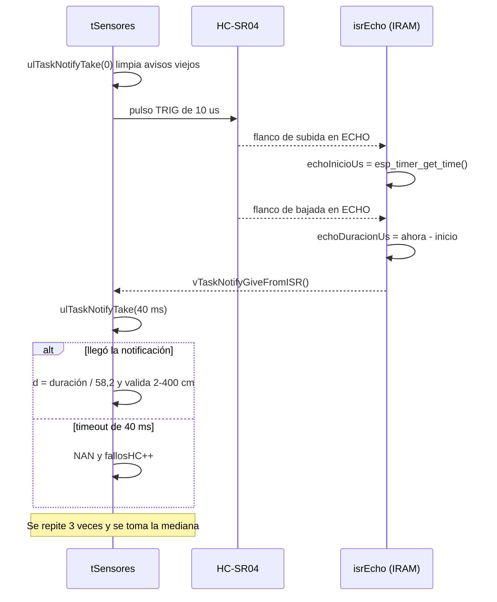
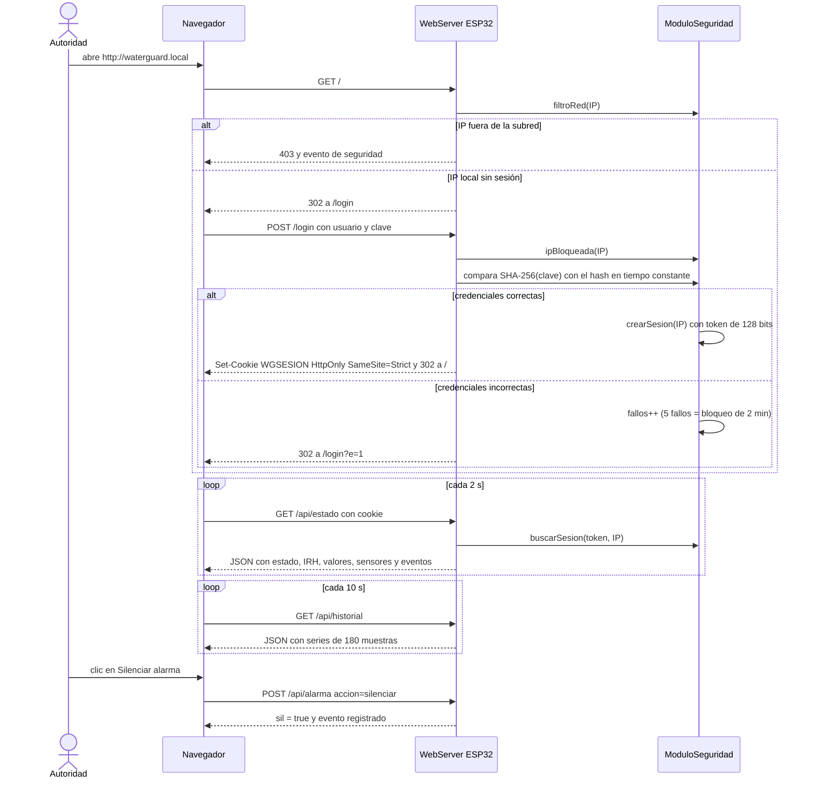
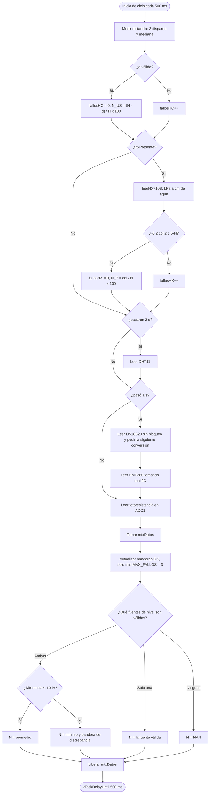
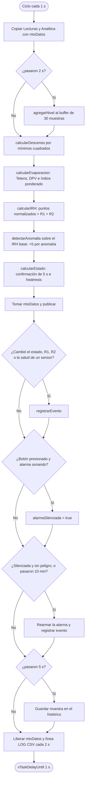
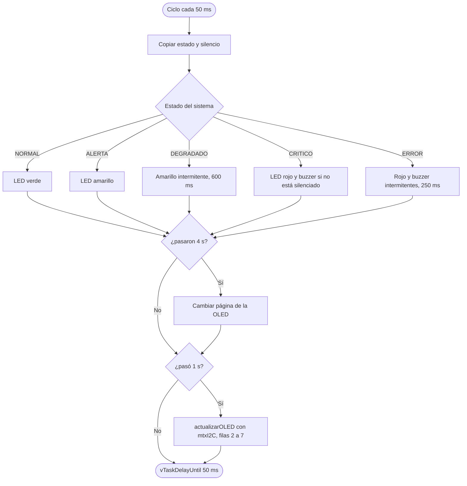
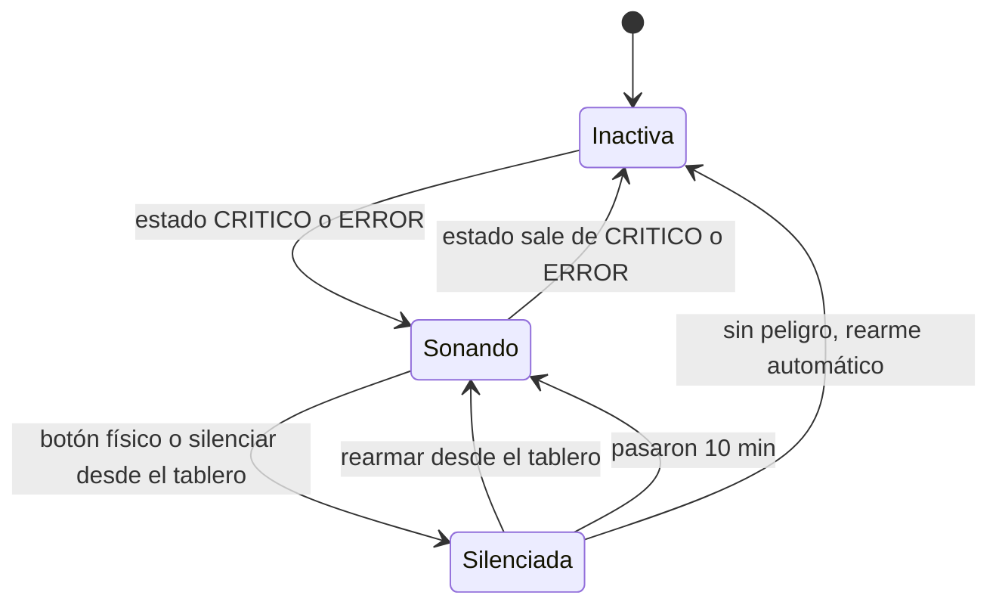
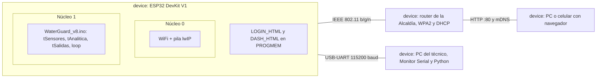

# 2.4. Diagramas UML de la solución y de cada módulo

Los diagramas se hicieron a partir del código real de `WaterGuard_v8.ino`: los nombres de estructuras, funciones y constantes coinciden con el firmware. Como el firmware está escrito en C++ para Arduino, sin clases propias, el diagrama de clases modela las **estructuras de datos** y los **módulos** (grupos de funciones) como clasificadores.

## 2.4.1. Diagrama de casos de uso

## 2.4.2. Diagrama de clases (estructuras y módulos)

> Todo acceso a `Lecturas`, `Analitica`, `Muestra` y `Evento` pasa por el mutex `mtxDatos`. El bus I2C tiene su propio mutex, `mtxI2C`.

## 2.4.3. Diagrama de secuencia: medición del HC-SR04 por ISR

## 2.4.4. Diagrama de secuencia: login y consulta del tablero

## 2.4.5. Diagrama de actividad: tarea de sensores (`tareaSensores`)

## 2.4.6. Diagrama de actividad: tarea de analítica (`tareaAnalitica`)

## 2.4.7. Diagrama de actividad: tarea de salidas (`tareaSalidas`)

> La OLED usa solo las filas 2 a 7 porque las filas 0 y 1 de la unidad están dañadas físicamente (ver [Retos](5.-Conclusiones,-Retos-del-Desarrollo,-Trabajo-Futuro-y-Referencias)).

## 2.4.8. Diagrama de estados: sistema y alarma

La máquina de estados del sistema está en la sección [2.3.6](2.3.-Desarrollo-Teórico-Modular). La alarma física tiene su propio ciclo de vida:

## 2.4.9. Diagrama de despliegue

