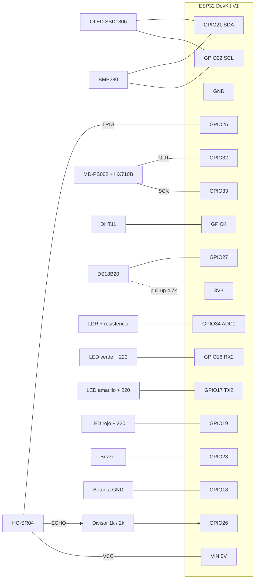

# 2.5. Esquemático de hardware

## 2.5.1. Lista de componentes

| # | Componente | Variable / función | Interfaz | Alimentación | Justificación |
|---|---|---|---|---|---|
| 1 | ESP32 DevKit V1 (WROOM-32, CP2102, 30 pines) | Procesamiento, WiFi y servidor web | — | USB 5 V → regulador 3,3 V | Doble núcleo Xtensa LX6 hasta 240 MHz y WiFi 802.11 b/g/n integrado [8], [23] |
| 2 | HC-SR04 | Nivel por ultrasonido | GPIO digital + ISR | **5 V (VIN)** | Sensor de nivel de bajo costo, validado en sistemas IoT de agua en zonas rurales [35], [36] |
| 3 | MD-PS002 + HX710B | Nivel por presión hidrostática | Serie de 2 hilos (24 bits) | 3,3 V | Segunda fuente de nivel, con un principio físico distinto (§[2.3.2](2.3.-Desarrollo-Teórico-Modular)) |
| 4 | DS18B20 sumergible | Temperatura del agua | 1-Wire | 3,3 V + pull-up de 4,7 kΩ | Encapsulado impermeable y resolución de 12 bits (0,0625 °C) [36] |
| 5 | DHT11 | Temperatura y HR del aire | Digital propietario | 3,3 V | Bajo costo; su HR alimenta el cálculo de $e_a$ [9] |
| 6 | BMP280 (opcional) | Presión atmosférica | I2C 0x76/0x77 [29] | 3,3 V | Aporta el término de presión de la evaporación (§2.3.4) |
| 7 | Fotoresistencia (LDR) + resistencia de divisor | Radiación / luminosidad relativa | ADC1 (GPIO34) | 3,3 V | Proxy de bajo costo de la radiación solar |
| 8 | OLED SSD1306 128×64 | Visualización in situ | I2C 0x3C [29] | 3,3 V | Legible a pleno sol y sin retroiluminación |
| 9 | LEDs verde, amarillo y rojo + 3 resistencias de 220 Ω | Estado del sistema | GPIO | — | Semáforo reconocible por cualquier persona |
| 10 | Buzzer activo | Alarma sonora | GPIO | 3,3 V | Alarma física exigida por el enunciado |
| 11 | Pulsador | Silenciar la alarma in situ | GPIO + ISR, pull-up interno | — | Acción local sin depender de la red |
| 12 | Resistencias de 1 kΩ y 2 kΩ | Divisor en el ECHO | — | — | Baja 5 V a ≈3,3 V para proteger el GPIO26 [8] |

## 2.5.2. Tabla de interconexión (pinout)

En la placa, el número después de la "D" es el número de GPIO. Los GPIO 16 y 17 aparecen rotulados como **RX2** y **TX2**.

| Componente | Pin del componente | GPIO ESP32 | Nota |
|---|---|---|---|
| OLED SSD1306 | SDA / SCK | 21 / 22 | Bus I2C compartido |
| BMP280 | SDA / SCL | 21 / 22 | Mismo bus I2C; se detecta en 0x76 o 0x77 |
| HC-SR04 | TRIG | 25 | Salida |
| HC-SR04 | ECHO | 26 | **Por el divisor de 1 kΩ / 2 kΩ**; ISR `CHANGE` |
| HX710B (MD-PS002) | OUT (DT) / SCK | 32 / 33 | OUT con `INPUT_PULLUP`: si se desconecta, queda en "sin dato" |
| DHT11 | DATA | 4 | |
| DS18B20 | DATA | 27 | Pull-up de 4,7 kΩ a 3,3 V |
| Fotoresistencia | Punto medio del divisor | 34 | ADC1, solo entrada, atenuación de 11 dB (0–3,3 V) |
| LED verde / amarillo / rojo | Ánodo, por 220 Ω | 16 (RX2) / 17 (TX2) / 19 | |
| Buzzer | + | 23 | Conexión directa (activo) |
| Botón | Un terminal (el otro a GND) | 18 | ISR `FALLING`, antirrebote de 250 ms |

**Pines evitados a propósito:** 0, 2, 12 y 15 (pines de arranque, *strapping*) y todo el **ADC2**, que no puede usarse mientras el WiFi está activo [8].

## 2.5.3. Esquemático de conexión

> **Pendiente del equipo:** reemplazar o complementar este diagrama con el esquemático gráfico exportado de Fritzing, EasyEDA o Wokwi del montaje v8. Esta tabla de pines es la fuente para dibujarlo. Los pines del primer corte (Arduino Uno) están en la [wiki del Challenge #1](https://github.com/LeMarsito02/IOTPROYECTOFINAL1CORTE/wiki/2.-Solución-Propuesta).

## 2.5.4. Consideraciones eléctricas

- **Niveles lógicos.** El ESP32 trabaja a 3,3 V y sus GPIO no toleran 5 V [8]. El único sensor alimentado a 5 V es el HC-SR04, porque su transmisor lo necesita. Su ECHO pasa por el divisor $V_{out} = 5\,\text{V}\cdot\frac{2\,\text{k}\Omega}{1\,\text{k}\Omega+2\,\text{k}\Omega} = 3{,}33\,\text{V}$.
- **Corriente por los LEDs.** Con 220 Ω y un LED rojo (≈2 V): $I = (3{,}3-2)/220 \approx 5{,}9\,\text{mA}$, dentro de la capacidad de un GPIO [8].
- **I2C.** La OLED y el BMP280 comparten el bus a 3,3 V. Los módulos traen resistencias de pull-up integradas [29]. El firmware escanea el bus al arrancar e informa por Serial las direcciones encontradas.
- **Tara del MD-PS002.** Hay que encender con la manguera fuera del agua. Las 15 primeras lecturas definen el "0 cm" (§2.3.2b).

## 2.5.5. Montaje físico

|  |  |
|---|---|
| **Figura 1.** Montaje del primer corte (v7): DS18B20 sumergido y caja de control con OLED y LEDs. La caja y los sensores ambientales se reutilizaron en la v8. | **Figura 2.** Mismo montaje sobre el segundo recipiente, con los tres LEDs de estado y la OLED encendida. |

**Challenge #3:** el nodo se integra en una carcasa de MDF de 3 mm cortada con láser, de ≈ 150 × 110 × 56 mm. La OLED y el panel solar van en la tapa, los LEDs y el botón al frente y el HC-SR04 en la base. Diseño, cotas y fotos en la [sección 2.8](2.8.-Diseño-Mecánico-Carcasa-y-Empaque).

> **Pendiente del equipo:** agregar las fotos del montaje v8 con el ESP32, el MD-PS002 y el BMP280 (Figura 5), y una captura del tablero web (Figura 6). El README también las espera.
