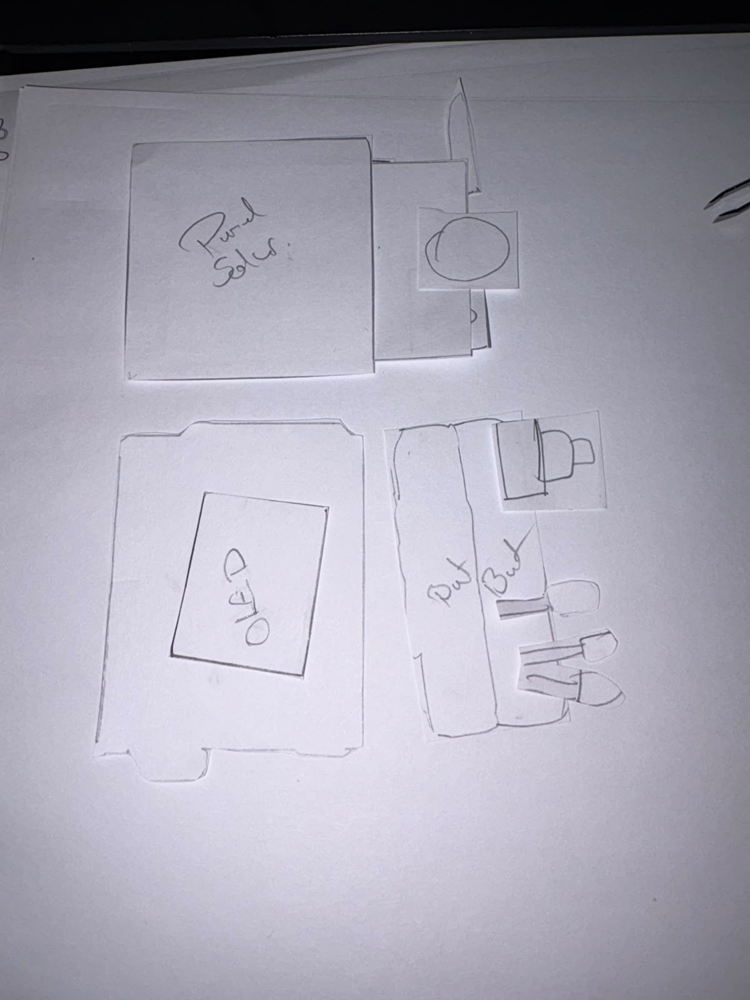
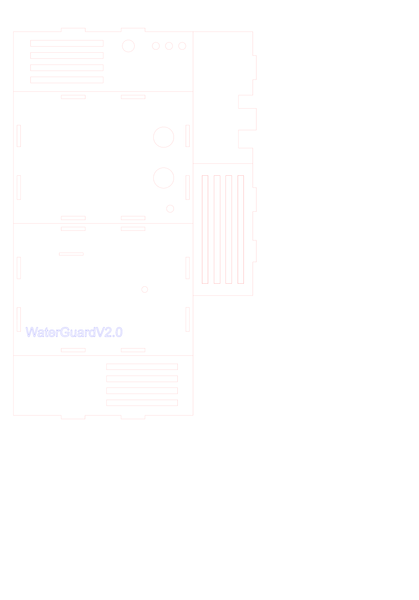
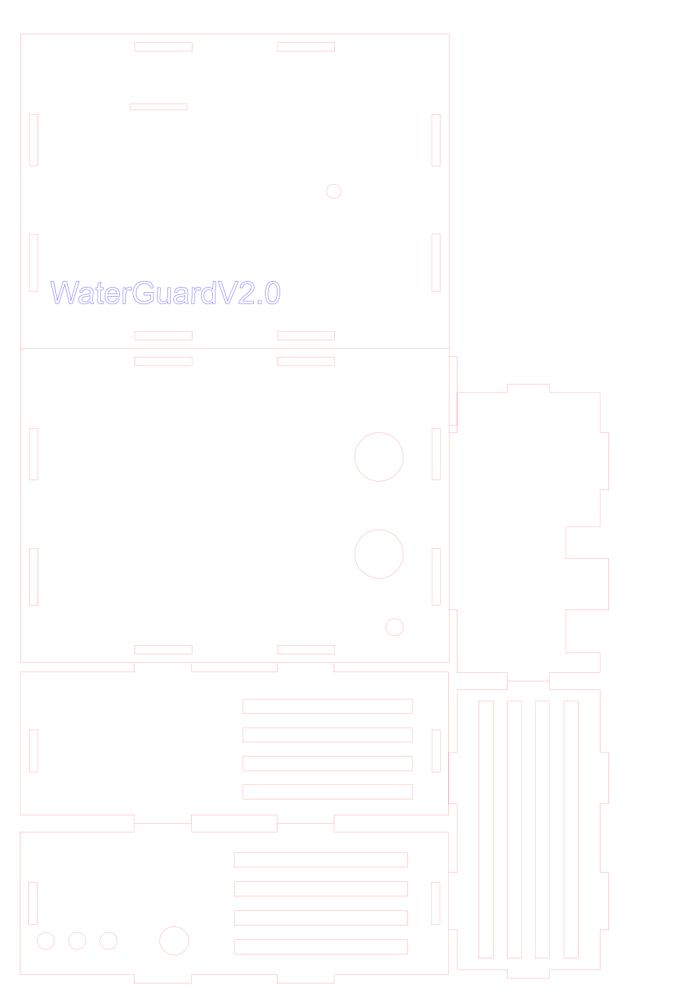
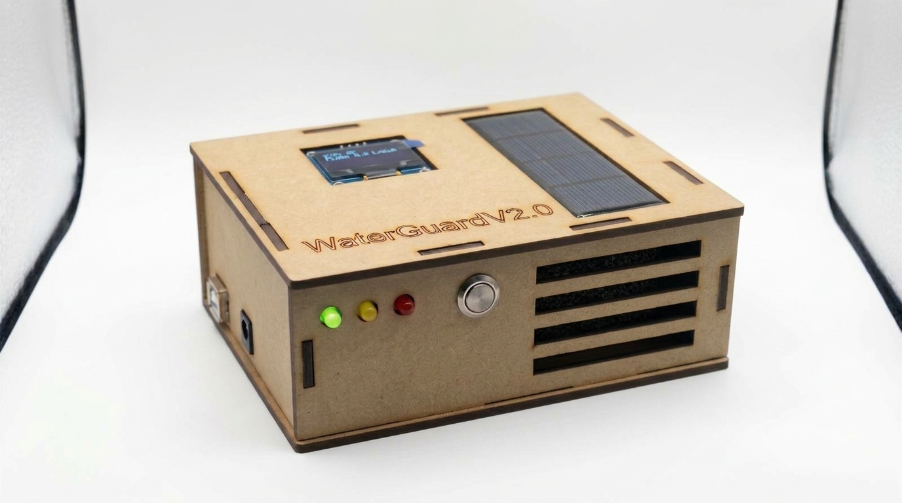
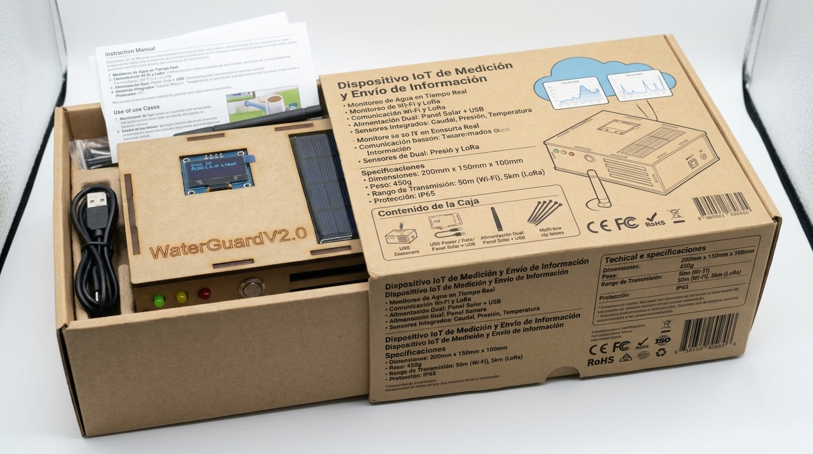
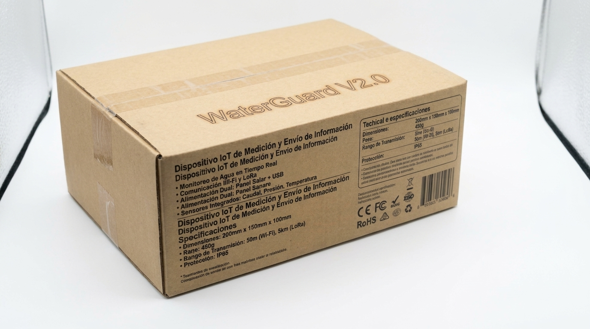
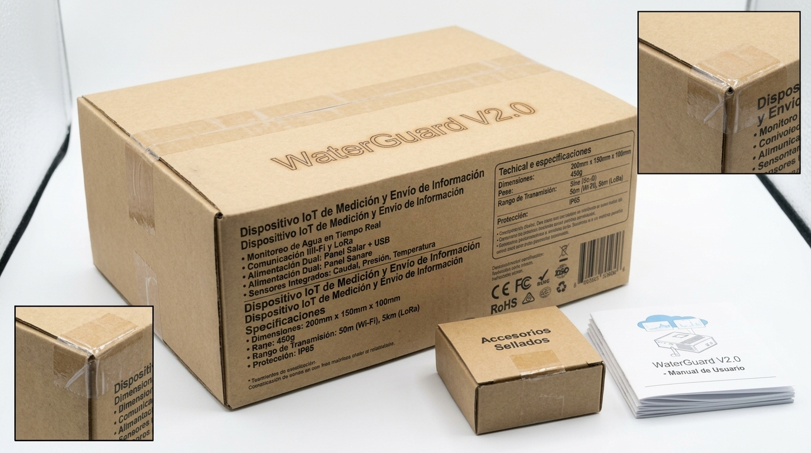

# 2.8. Diseño mecánico: carcasa y empaque

El Challenge #3 presenta el nodo como **producto**: una carcasa que protege la electrónica y ubica bien los elementos que necesitan contacto con el exterior, y un empaque para su entrega. Esta página documenta el diseño, la decisión de material y su fabricación.

## 2.8.0. Ideación: lluvia de ideas, *Crazy 8s* y maqueta en papel

Antes de diseñar la plantilla de corte, el equipo hizo sesiones de **lluvia de ideas** y de ***Crazy 8s*** (ocho bocetos rápidos en ocho minutos por persona [59]) para explorar distribuciones de los componentes. Las mejores ideas se llevaron a **bocetos y a una maqueta en papel recortado**, de costo casi nulo, para probar:

- **Distribución:** qué va en la tapa (OLED, panel solar), qué va al frente (botón y LEDs) y qué va en la base (HC-SR04 hacia el agua).
- **Conectividad:** por dónde pasan los cables de los sensores externos y el USB de programación.
- **Fidelidad de la medición:** separar la ventilación del calor de la electrónica, para que el DHT11 y el BMP280 midan el aire del ambiente y no el interior de la caja.

|  |  |
|---|---|
| **Figura 18.** Maqueta en papel de la etapa de ideación: tapa con panel solar, panel de la OLED y frente con botón y tres LEDs. | **Figura 19.** Primera plantilla de corte (v1), que pasa la maqueta a piezas con encastres. |

La maqueta permitió fijar la distribución que luego se llevó a la plantilla v1 y se refinó en la v2.0 (2.8.2).

## 2.8.1. Decisión de material: de impresión 3D a MDF de 3 mm cortado con láser

El plan inicial ([sección 0](0.-Plan-del-Challenge-3), decisión D5) era imprimir la carcasa en 3D en PETG o ASA. Se llegó a diseñar en OpenSCAD (base, tapa con alero contra lluvia, adaptador de la OLED y soporte para el tanque, en [`diseno/carcasa-impresa-3d/`](https://github.com/Juan100205/IOTPROYECTOFINAL3CORTE/tree/main/diseno/carcasa-impresa-3d)), con 9–12 h de impresión estimadas para las dos piezas. En la reunión de seguimiento del 6 de noviembre ([Acta #2](7.1.-Actas-de-Reunión-y-Evaluación)) el equipo cambió a **MDF de 3 mm cortado con láser**:

| Criterio | Impresión 3D (PETG/ASA) | MDF de 3 mm con corte láser | Peso en la decisión |
|---|---|---|---|
| **Economía** | Filamento técnico y horas de máquina | **COP 35.000** la carcasa completa ([2.7](2.7.-Modelo-de-Negocio)) | Presupuesto estudiantil (restricción E3) |
| **Tiempo** | ≈ 7 h por pieza, sin margen para reimprimir antes del 9 de noviembre | Minutos de corte por lámina; una iteración del diseño cabe en el mismo día | Cronograma de 7 días (restricción temporal) |
| **Facilidad de fabricación y ensamble** | Requiere ajustar holguras, soportes y orientación de impresión | Piezas planas en **una sola lámina de 245 × 350 mm**, unidas por encastres tipo *finger joint*; el diseño 2D se corrige y se vuelve a cortar rápido | Equipo de dos personas |
| **Biodegradabilidad / impacto ambiental** | Termoplásticos de origen fósil | Tablero de fibras de madera (material lignocelulósico) | Criterio ambiental de la rúbrica (diseño ingenieril) |
| **Comportamiento con el calor** | **Se descartó porque el plástico impreso se deforma con el calor** del halógeno del banco de pruebas y de la exposición al sol del tanque | No se ablanda ni se deforma a esas temperaturas | Decisivo: la carcasa debe resistir el banco de pruebas y el campo |
| **Resistencia a la humedad y al sol** | Alta (ASA resiste rayos UV) | **Baja**: el MDF se hincha con agua | Desventaja aceptada para el prototipo (ver 2.8.5) |

> **Nota sobre biodegradabilidad.** El MDF es mayoritariamente fibra de madera, pero se aglomera con resinas sintéticas. Por eso se presenta como una alternativa **de menor impacto que los plásticos de impresión**, no como un material 100 % biodegradable.

## 2.8.2. Diseño de la carcasa (plantilla de corte v2.0)

La carcasa aloja el **nodo sensor**: ESP32, módulos (HX710B, convertidores), OLED, LEDs, buzzer, botón y cableado. La Raspberry Pi 5 (Gateway) va por separado, para que su calor no altere la temperatura del aire que mide el nodo.

|  |  |
|---|---|
| **Figura 11.** Plantilla de corte láser v2.0 (lámina de 245 × 350 mm). Rojo: corte; azul: grabado del nombre "WaterGuardV2.0". | **Figura 12.** Carcasa ensamblada, con OLED y panel solar en la tapa, y LEDs, botón y rejilla al frente.\* |

**Cotas tomadas de la plantilla v2.0** ([`plantilla-carcasa-v2.0.pdf`](https://github.com/Juan100205/IOTPROYECTOFINAL3CORTE/blob/main/diseno/carcasa-mdf/v2.0/plantilla-carcasa-v2.0.pdf)):

| Pieza | Medidas (mm) | Perforaciones y función |
|---|---|---|
| Tapa | 150 × 110 | Grabado del nombre; ventana para la OLED y alojamiento del panel solar |
| Base | 150 × 110 | **2 orificios de Ø 17 mm** para los transductores del HC-SR04, que mide hacia el agua desde arriba; orificio para el paso de cables |
| Frente | 150 × 56 | **3 orificios de ≈ Ø 5 mm** para los LEDs verde, amarillo y rojo; orificio para el botón de silencio; **4 ranuras de 59,4 × 5 mm** de ventilación |
| Trasera | 150 × 56 | 4 ranuras de ventilación |
| Laterales (2) | 56 × 104 | Ranuras de ventilación verticales; aberturas para el USB de programación y la alimentación |
| Encastres | Ranuras de **3 mm** | Iguales al espesor del MDF: las piezas se arman por encaje |

Las dimensiones externas resultantes son de **≈ 150 × 110 × 56 mm**.

**Iteración v1 → v2.0.** La primera plantilla ([v1](https://github.com/Juan100205/IOTPROYECTOFINAL3CORTE/tree/main/diseno/carcasa-mdf/v1), lámina de 350 × 500 mm) definía una caja de 150 × 110 × 53 mm. En la v2.0 se subió la altura a 56 mm para dar espacio al cableado y se agregaron las perforaciones de interfaz (LEDs, botón, HC-SR04 y ventilación) y el grabado. Además, toda la carcasa quedó en una lámina más pequeña.

|  |
|---|
| **Figura 13.** Plantilla de corte v1 (primera iteración). |

## 2.8.3. Criterios de diseño para manufactura (DFM) aplicados

- **Un solo material y un solo espesor** (MDF de 3 mm): todas las piezas salen de una lámina en un solo trabajo de corte.
- **Ranuras de encastre iguales al espesor** (3 mm), para que las piezas se ensamblen por encaje y la carcasa se pueda abrir para reprogramar el ESP32.
- **Capas separadas en la plantilla** (corte en rojo y grabado en azul), como las piden las cortadoras láser.
- **Ubicación funcional de la interfaz:** la OLED y el panel quedan en la tapa, visibles desde arriba; LEDs y botón al frente; HC-SR04 en la base, apuntando al agua; y ventilación en tres caras, para que el calor de la electrónica no altere la lectura del DHT11 ni la del BMP280.
- **Archivos editables versionados:** fuente en Affinity (`.af`) y plantilla exportada a PDF/SVG en [`diseno/carcasa-mdf/`](https://github.com/Juan100205/IOTPROYECTOFINAL3CORTE/tree/main/diseno/carcasa-mdf).

## 2.8.4. Empaque de cartón

La unidad se entrega en una **caja de cartón corrugado tipo *mailer*** con inserto interno que inmoviliza la carcasa, el cable USB y los accesorios. Costo de fabricación: **COP 10.000** ([2.7](2.7.-Modelo-de-Negocio)).

|  |  |
|---|---|
| **Figura 14.** Empaque abierto: carcasa en su inserto, cable USB y manual.\* | **Figura 15.** Empaque cerrado y sellado.\* |

|  |
|---|
| **Figura 16.** Empaque, caja de accesorios sellada y manual de usuario.\* |

> \* **Sobre las fotografías (Figuras 12, 14, 15 y 16).** Son fotos reales del prototipo y del empaque, **mejoradas con Gemini (Google)** para mejorar la calidad fotográfica (declarado en la [sección 9](9.-Uso-de-Herramientas-de-Inteligencia-Artificial)). La mejora alteró el texto impreso de la caja: los rótulos que mencionan **LoRa, alcance de 5 km, IP65, 200 × 150 × 100 mm, 450 g y los sellos CE, FCC y RoHS no corresponden al producto real**. Las especificaciones válidas son las de esta página y la [sección 2.5](2.5.-Esquemático-de-Hardware): comunicación WiFi de 2,4 GHz, carcasa de ≈ 150 × 110 × 56 mm en MDF de 3 mm, sin grado IP certificado y sin certificaciones de producto.

## 2.8.5. Limitaciones y paso a producción

| Limitación del prototipo | Mitigación en el prototipo | Para producción |
|---|---|---|
| El MDF absorbe humedad y no alcanza un grado IP según IEC 60529 [55] | Carcasa ubicada sobre el tanque y no dentro del agua; los sensores sumergibles (DS18B20, manguera del MD-PS002) salen por la base | Sellar el MDF (laca o barniz) o pasar a ASA/policarbonato con empaques, con meta IP54 |
| Calidad del tablero según EN 622-5 [54] | MDF comercial de 3 mm | Especificar MDF apto para humedad (tipo MDF.H) si se mantiene la madera |
| Panel solar sin validación eléctrica de autonomía | Alimentación por USB durante las pruebas | Dimensionar panel, regulador y batería según el consumo medido del nodo |
