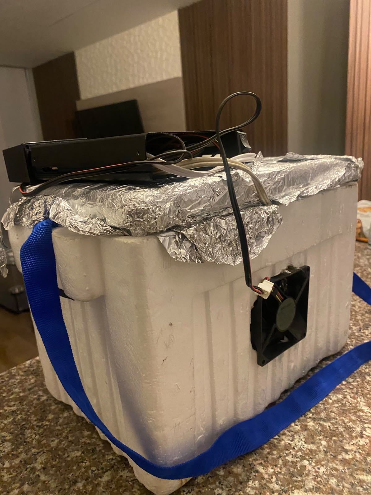
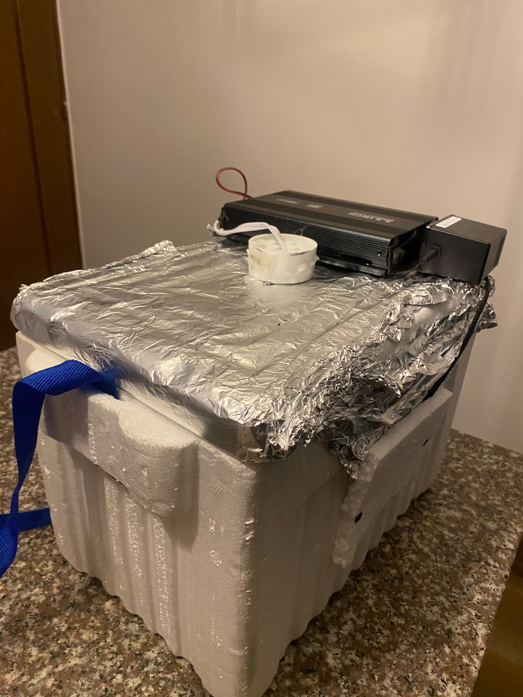
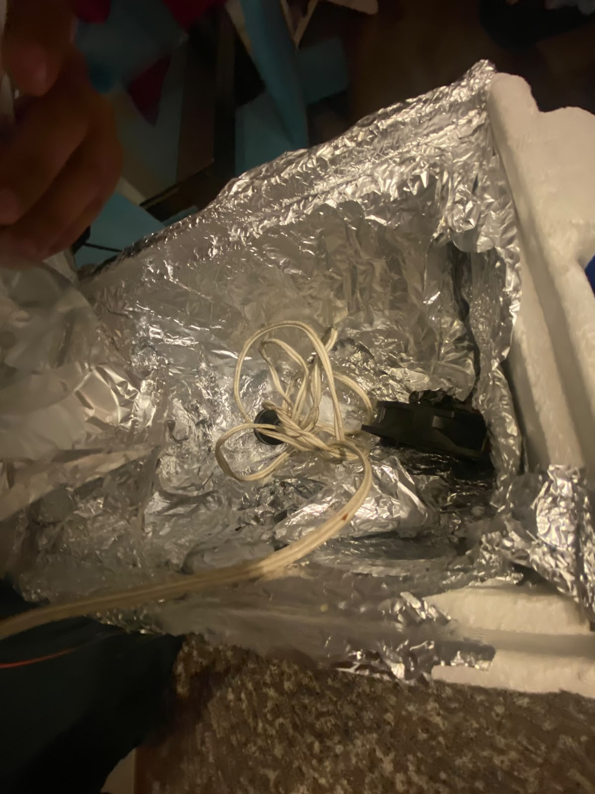
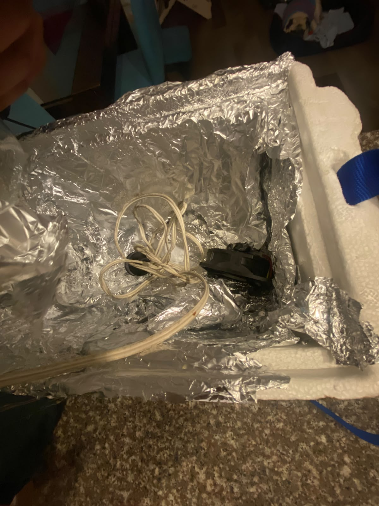
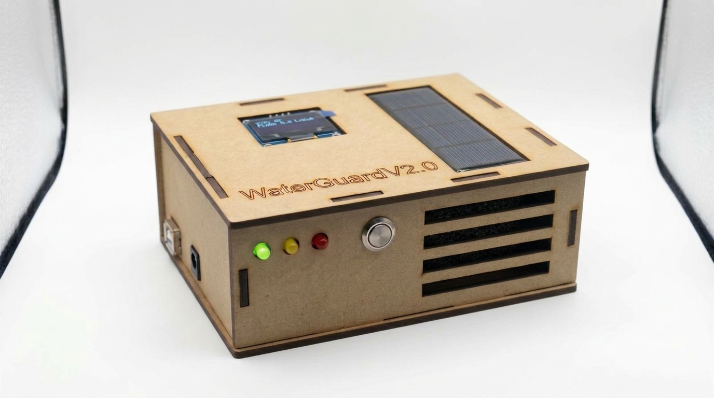
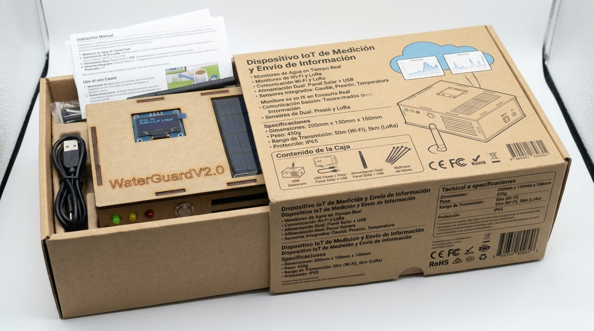

# 3. Configuración experimental, resultados y análisis

## 3.1. Banco de pruebas

Para simular el ecosistema del tanque se construyó una cámara controlada con una **nevera de icopor**: las paredes internas se forraron con **aluminio** para distribuir el calor, un **bombillo halógeno** actúa como fuente de calor (y de radiación) y un **ventilador** genera flujo de aire que simula viento. Así se pueden provocar, de forma repetible, las condiciones de calor, sequedad y viento que aceleran la evaporación [9].

|  |  |
|---|---|
| **Figura 7.** Nevera de icopor con aluminio interno, ventilador y fuente de calor. | **Figura 8.** Vista frontal con el ventilador. |
|  |  |
| **Figura 9.** Interior forrado en aluminio, con el bombillo halógeno. | **Figura 10.** Detalle del bombillo y el cableado dentro de la cámara. |

|  |  |
|---|---|
| **Figura 1.** Nodo WaterGuard v9 ensamblado en la carcasa de MDF: OLED y panel solar en la tapa; LEDs de estado, botón de silencio y rejilla de ventilación al frente.\* | **Figura 2.** El nodo en su empaque, con el inserto, el cable USB y el manual de usuario.\* |

\* Fotos reales mejoradas con Gemini ([sección 9](9.-Uso-de-Herramientas-de-Inteligencia-Artificial)). Los textos impresos en la caja no son especificaciones válidas ([2.8.4](2.8.-Diseño-Mecánico-Carcasa-y-Empaque)).

### 3.1.1. Banco de pruebas v2: adecuación a la carcasa MDF (Challenge #3)

Con el cambio de carcasa a MDF de 3 mm ([2.8](2.8.-Diseño-Mecánico-Carcasa-y-Empaque)), el banco se reorganizó para **soportar el nuevo diseño**. Un soporte fijo sostiene la carcasa sobre la cámara, con el HC-SR04 (que sale por la base) apuntando al agua. Así la distancia y la orientación del sensor son las mismas en todas las corridas y las mediciones son repetibles.

|  |
|---|
| **Figura 17.** Carcasa MDF que se monta en el banco v2 (foto real mejorada con Gemini; ver [sección 9](9.-Uso-de-Herramientas-de-Inteligencia-Artificial)). |


**Registro de datos.** El firmware emite cada 2 s por Serial (115200 baudios) una línea CSV:

```
LOG,millis,nivel,nivelUS,nivelP,tAgua,tAmb,humedad,presion,luminosidad,evap,dpv,descenso,irh,anomalias,estado
```

Esa línea se exporta y se analiza en Python con estadística descriptiva y K-Means [10]. El formato de la v7 tenía menos columnas; ver [Anexos](6.-Anexos).

## 3.2. Resultados heredados del Challenge #1 (lógica de analítica)

La máquina de estados, el conteo de fallos por sensor, la detección de anomalías (±2σ, ventana de 10) y la fórmula `IRH = IRHbase + 5·anomalías` **no cambiaron de la v7 a la v8** (ver [2.3](2.3.-Desarrollo-Teórico-Modular)). Por eso las pruebas del primer corte siguen siendo evidencia válida de esa lógica.

### Prueba 1: línea base (102 muestras, ~214 s, sin perturbaciones)

| Variable | Mínimo | Máximo | Media | Desv. estándar |
|---|---|---|---|---|
| Nivel (%) | 52,92 | 54,12 | 53,25 | 0,44 |
| Temp. agua (°C) | 18,31 | 18,44 | 18,38 | 0,04 |
| Temp. ambiente (°C) | 18,70 | 19,00 | 18,83 | 0,06 |
| Humedad (%) | 54,00 | 54,00 | 54,00 | 0,00 |
| Luminosidad (%) | 54,94 | 68,72 | — | 1,36 |
| Evaporación v7 (%) | 47,97 | 50,78 | 50,65 | 0,28 |
| IRH | 0 | 0 | 0 | 0 |

El sistema permaneció en `NORMAL` todo el tiempo. La pendiente del nivel (≈ −0,0007 %/s) no se distingue del ruido del HC-SR04 sobre agua en reposo.


**Figura 3.** OLED en operación durante la Prueba 1: `Estado: NORMAL`, `Anomalia: NO`, nivel, temperaturas, humedad y evaporación.

### Prueba 2: perturbaciones deliberadas (44 muestras, ~92 s)


**Figura 4.** Nivel, temperatura del agua, luminosidad e IRH durante la Prueba 2. La zona `DEGRADADO` está sombreada y las anomalías se marcan con ×.

| Tiempo (s) | Perturbación | Respuesta observada |
|---|---|---|
| 0–17 | Reposo | Nivel ~53 %, IRH = 0, `NORMAL` |
| 22–36 | HC-SR04 bloqueado | Nivel = NAN durante 7 muestras: tras `MAX_FALLOS` = 3, `hcOK` = false → `DEGRADADO` |
| 39 | Se libera el sensor | El nivel vuelve a reportarse (33,68 %) |
| 39–71 | Calor sobre el DS18B20 | T agua sube de 18,4 a 25,4 °C; el IRH sigue en 0 porque ninguna variable cruza su umbral |
| 73–75 | T agua de 26,3–26,8 °C y nivel de 30,76 % | Primera anomalía: IRH = 0 + 1×5 = **5,0** |
| 78–84 | Nivel < 30 % | IRH base = 25/95×100 = **26,32** |
| 91–97 | LDR tapada y nivel < 30 % | La evaporación cae de ~60 % a ~46 %; con una anomalía activa, IRH = **31,32** → `ALERTA` |

**Validación cruzada:** el IRH registrado coincide muestra por muestra con el cálculo manual de la fórmula del firmware.

### Análisis offline con K-Means (Prueba 2)

Se aplicó K-Means [10] sobre nivel, temperatura del agua y luminosidad estandarizados. Es la misma técnica del trabajo de referencia del curso, donde K-Means superó a k-NN como clasificador (70,2 % de clasificación correcta) [5].

| k | Silhouette |
|---|---|
| 2 | 0,603 |
| 3 | 0,679 |
| **4** | **0,762** |

| Clúster | Nivel medio | T agua media | Luminosidad media | Interpretación |
|---|---|---|---|---|
| A | 52,0 % | 18,4 °C | 68,5 % | Reposo |
| B | 34,0 % | 20,3 °C | 68,4 % | Post-recuperación y calentamiento incipiente |
| C | 31,8 % | 27,6 °C | 68,3 % | Estrés térmico con nivel bajo |
| D | 30,5 % | 28,1 °C | 3,0 % | Evento compuesto: calor + nivel bajo + sin luz |

Los clústeres corresponden a condiciones físicas interpretables: el análisis offline separa el reposo de los distintos grados de severidad de un evento.

## 3.3. Protocolo de pruebas de la v8

Las pruebas nuevas cubren lo que cambió en la v8: ISR/RTOS, redundancia de nivel, evaporación física, tablero y seguridad.

| ID | Prueba | Procedimiento | Resultado esperado |
|---|---|---|---|
| V1 | Medición fuera del hilo principal | Recargar el tablero muchas veces seguidas mientras se mide | Periodo de `tSensores` estable en 500 ms; la OLED no se congela |
| V2 | Fusión con fuentes concordantes | Nivel estable con HC-SR04 y MD-PS002 | `nivel` = promedio, sin discrepancia |
| V3 | Discrepancia de nivel | Obstruir el HC-SR04 (eco falso) con el MD-PS002 sumergido | Se usa el mínimo y aparece el evento "Discrepancia de nivel" |
| V4 | Falla de una fuente de nivel | Desconectar el HX710B | Evento "MD-PS002 sin lectura"; el sistema sigue con el HC-SR04 |
| V5 | Descenso anómalo con calor (R1) | Vaciar el recipiente a más de 1 %/min con el halógeno encendido | Evento "Descenso anómalo con calor", IRH +20 |
| V6 | Estado `CRITICO` sostenido | Nivel < 15 % + calor durante más de 5 s | LED rojo, buzzer y evento crítico en el tablero |
| V7 | Histéresis | Bajar el IRH de 70 a 65 y luego a menos de 60 | Sigue en `CRITICO` hasta que IRH < 60 |
| V8 | Fallo total (`ERROR`) | Desconectar todos los sensores de datos | Rojo y buzzer intermitentes, pantalla de ERROR |
| V9 | Evaporación física | Encender halógeno y ventilador, luego apagarlos | El DPV y el índice suben con el calor y bajan al enfriar |
| S1 | Acceso desde la WLAN con credenciales | Iniciar sesión desde el celular | Tablero visible, actualización cada 2 s |
| S2 | Clave incorrecta ×5 | Intentar 5 veces con una clave errada | Bloqueo de la IP por 2 min + eventos de seguridad |
| S3 | Robo de cookie desde otra IP | Copiar la cookie a otro dispositivo | 401 o redirección a login |
| S4 | IP fuera de la subred | Petición enrutada desde otra red | 403 y evento "Acceso rechazado" |
| A1 | Silenciar desde el tablero | Botón "Silenciar" en `CRITICO` | El buzzer se apaga y queda el evento con la IP |
| A2 | Silenciar con botón físico | Pulsar el botón en `CRITICO` | El buzzer se apaga |
| A3 | Rearme automático | Silenciar y luego salir de `CRITICO` | Evento "Alarma rearmada automáticamente" |
| W1 | Caída del WiFi | Apagar el router | La alerta local sigue funcionando; evento "WiFi perdido" y reconexión |


## 3.4. Análisis

- La lógica de fusión y de estados heredada quedó validada con datos reales (Pruebas 1 y 2).
- La v8 agrega redundancia en la variable crítica: con dos principios físicos, la falla de un sensor de nivel ya no lleva al sistema a `DEGRADADO`, siempre que la otra fuente responda [6], [20].
- El nuevo índice de evaporación tiene base física (DPV) [9]. La prueba V9 debe mostrar cómo responde frente al índice heurístico de la v7, que en la Prueba 2 cayó de ~60 % a ~46 % solo por tapar la luz.

## 3.5. Evidencias del ecosistema v9

### Prueba automatizada del Gateway: alerta por falla de la base de datos (P3)

Siguiendo el enfoque TDD ([4.0](4.-Autoevaluación-del-Protocolo-de-Pruebas)), la prueba [`prueba_alerta_bd.py`](https://github.com/Juan100205/IOTPROYECTOFINAL3CORTE/blob/main/codigo/gateway/pruebas/prueba_alerta_bd.py) simula un disco lleno durante tres escrituras consecutivas, sin broker ni nube:

| Paso | Qué se provoca | Resultado obtenido |
|---|---|---|
| 1 | Falla de escritura en SQLite (`database or disk is full`) | Alerta crítica activa; 2 muestras retenidas; el ESP32 recibe "FALLA BD GATEWAY: datos retenidos, revisar la SD" |
| 2 | Llega una muestra nueva mientras la base sigue fallando | Queda retenida detrás de las anteriores, en orden (`seq` 2, 3, 4) |
| 3 | La base se recupera | Las 5 muestras quedan guardadas en orden (`seq` 1–5), la alerta se apaga en el ESP32 y en la nube, y se restablece la última recomendación |

**Resultado:** prueba superada (10 de noviembre de 2026).

### Base estadística del módulo de IA

Con 30 min de datos sintéticos en SQLite y un descenso de 1 %/min (del 60 % al 31 %), la base estadística estimó una tasa de −60 %/h y **0,3 h** hasta el umbral crítico del 15 %, igual al cálculo manual ((31 − 15) / 60 = 0,27 h). La recomendación de respaldo fue "Activar racionamiento inmediato e inspeccionar fugas", con riesgo crítico.

### Tablero global

El tablero de LeMarTek Cloud está desplegado y accesible con el rol de autoridad (Figura 20, [2.2.0](2.2.-Arquitectura-Propuesta)).
