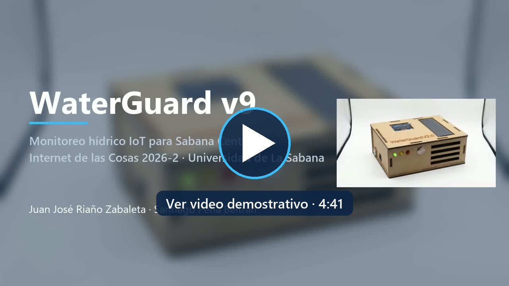

# 8. Video demostrativo

Video de validación del prototipo funcional WaterGuard v9 (4:41).

▶️ **[Reproducir el video](https://github.com/Juan100205/IOTPROYECTOFINAL3CORTE/blob/main/docs/video/WaterGuard_v9_video.mp4)** · [Descargar (MP4, 1080p)](https://raw.githubusercontent.com/Juan100205/IOTPROYECTOFINAL3CORTE/main/docs/video/WaterGuard_v9_video.mp4)

## Capítulos

| Tiempo | Bloque | Qué se muestra |
|---|---|---|
| 0:00 | Título | WaterGuard v9 · Universidad de La Sabana |
| 0:03 | 1. Presentación y contexto | Los 20 municipios de Cundinamarca en riesgo extremo y el problema de enterarse tarde |
| 0:35 | 3. Solución ideal | Red por niveles: tanque (ESP32), municipio (Gateway) y departamento (LeMarTek Cloud) e IA |
| 1:10 | 4. Banco de pruebas | Nevera con aluminio, halógeno, ventilador y soporte de la carcasa |
| 1:39 | Prueba de caída del Gateway | El nodo guarda las muestras en su cola y las reenvía en orden |
| 1:52 | 5. Producto | Carcasa en MDF de 3 mm cortada con láser; descarte de la impresión 3D por el calor |
| 2:23 | 6. Conexiones y código | Pines del ESP32, firmware con ISR y FreeRTOS, Gateway con SQLite y alerta de la base de datos, IA con Claude |
| 3:30 | 7. Tablero global e IA | LeMarTek Cloud y el control remoto de la alarma |
| 3:53 | 8. Comercialización | Costo de producción, precio por nodo y por municipio |
| 4:19 | 9. Conclusiones | Cumplimiento de las cinco restricciones, trabajo futuro y cierre |

La correspondencia de cada bloque con las pruebas del plan TDD está en la [sección 4.0.1](4.-Autoevaluación-del-Protocolo-de-Pruebas).
